# Accounts that follow HR (joiners, movers and leavers)

**The problem:** In many banks, accounts are created from tickets and leavers stay active for days. Stale and orphaned accounts are among the most common access-control audit findings.

**What I built:** HR data drives Active Directory. A PowerShell script sends HR records to Microsoft's API-driven inbound provisioning, which creates each account in its department OU, updates it when the person moves, and disables it when they leave. Microsoft Entra Cloud Sync syncs the accounts to the cloud, where dynamic department groups keep themselves up to date.

## Results

- **Joiner:** Zadi Murenzi's account created in Active Directory from one HR record, in the right OU, with a valid sAMAccountName.
- **Mover:** Noella Uwineza's title, department and OU changed from one line in the HR file, with no ticket.
- **Leaver:** Julie Uwamahoro's account disabled from one line in the HR file and removed from her department group automatically 17 minutes later, with every step logged.
- **No stored credentials:** the sync agent runs as a gMSA, and the script's client secret is entered at run time, never saved.

**Built with:** Windows Server 2022 Active Directory, Microsoft Entra ID (formerly Azure AD), Microsoft Entra Cloud Sync, API-driven inbound provisioning, dynamic groups, PowerShell and Microsoft Graph.

## Files in this folder

| File | What it is |
| --- | --- |
| [hr-feed.ps1](hr-feed.ps1) | Sends HR records to the provisioning API; prompts for the client secret at run time |
| [hr_feed_initial.csv](hr_feed_initial.csv) | HR export used for the joiners |
| [hr_feed_after_changes.csv](hr_feed_after_changes.csv) | The same export after the mover and leaver changes |
| [mappings.md](mappings.md) | The two attribute-mapping changes the provisioning app needed |

## Evidence, step by step

HR is the source of truth. When HR hires someone, their Active Directory account is created automatically; when they change department, the account follows; when they leave, it is disabled. Every step is logged. The screenshots below follow that story in order, all taken on 25 October 2026.

### Setting up the bank's directory

**1. OU structure in Active Directory.** Active Directory Users and Computers on DC01, domain corp.equitybankltd.lab. The bank's OU, EquityBankLtd, contains Groups, Service Accounts and Users, with one OU per department under Users: Finance, Human Resources and Operations.

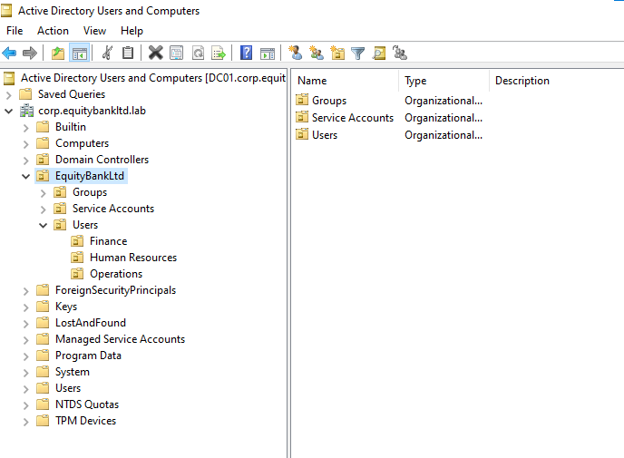

**2. Ronald Ndatinya's account in Active Directory.** Ronald's Attribute Editor tab: employeeID 100101, and a distinguishedName in the Finance OU. The employee ID is what ties his account to his HR record. Noella Uwineza also appears in Finance because this was taken after her move (screenshot 16).

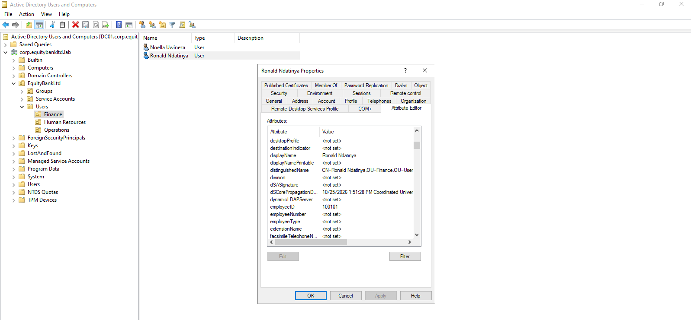

### Syncing to Microsoft Entra ID with Cloud Sync

**3. Cloud Sync configuration is healthy.** The Cloud Sync configuration for corp.equitybankltd.lab, syncing AD to Microsoft Entra ID (formerly Azure AD), shows Healthy. The other two configurations, kigalilab.com and zenworks.com, belong to other setups in the same tenant and are not part of this project.

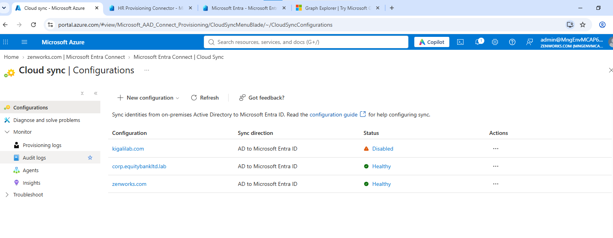

**4. Provision on demand: Ronald.** A provision-on-demand test for Ronald. All four steps passed: import, scope check, match, and create. The export details confirm rndatinya@corp.equitybankltd.lab was created in Microsoft Entra ID with department Finance, company Equity Bank Ltd and employee ID 100101.

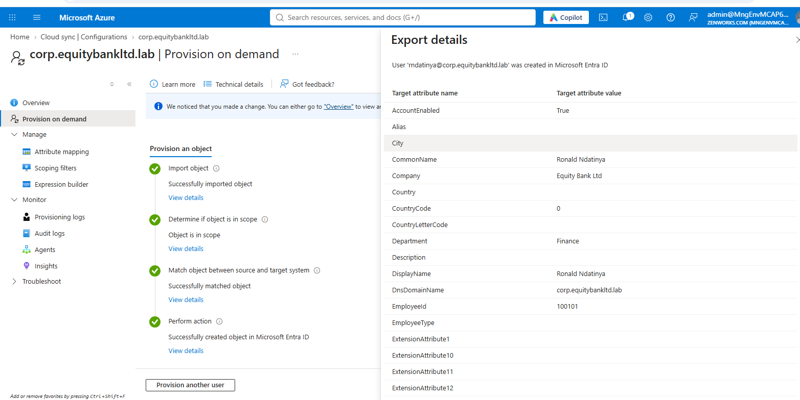

**5. Cloud Sync provisioning log for Ronald.** Cloud Sync's provisioning log, filtered on "ronald", shows three entries (1:59, 2:02 and 2:17 PM). The selected entry lists the values written to his cloud account: account enabled, department Finance, company Equity Bank Ltd and employee ID 100101, matching Active Directory (screenshot 2).

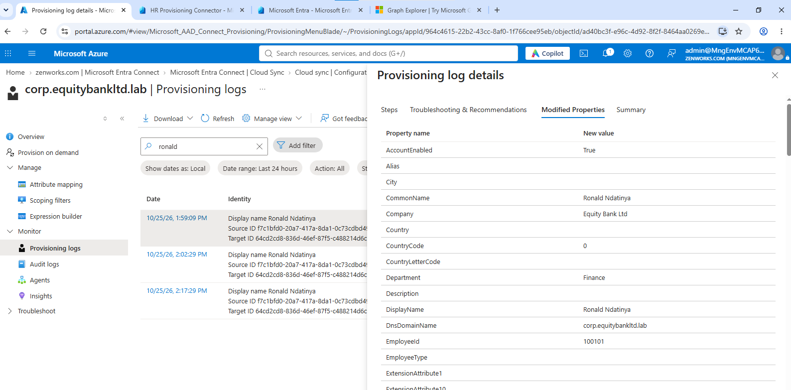

### The HR provisioning connection

**6. HR to Active Directory Provisioning is running.** The API-driven inbound provisioning app that receives HR records and writes them to Active Directory. Start provisioning is greyed out and Pause is available, so the job is running. Last cycle completed at 2:21:18 PM UTC, with one agent enabled.

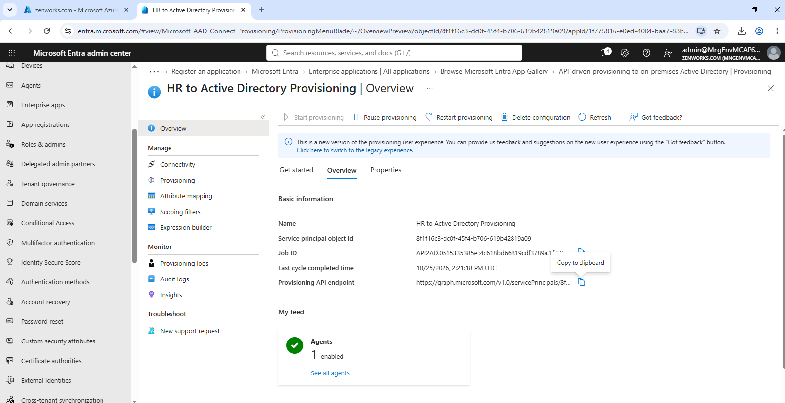

**7. Provisioning agent on DC01 is active.** The app uses the provisioning agent installed on DC01, the same agent Cloud Sync uses. DC01.corp.equitybankltd.lab is configured for this domain and active. DC.zenworks.com is listed under agents not configured for this domain and plays no part here.

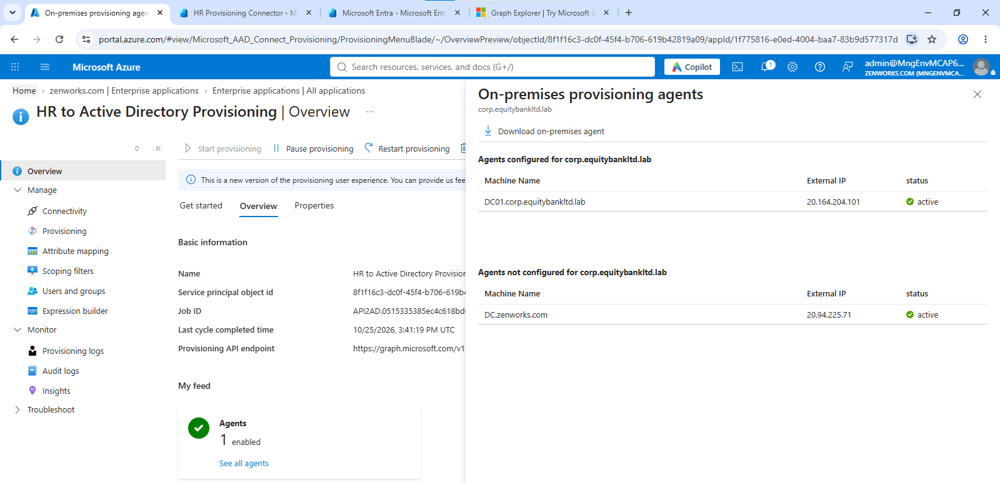

### First joiner: Zadi Murenzi

**8. Zadi Murenzi created from one HR record.** The provisioning log for the first single HR record, employee 100102, at 2:26:19 PM. All four steps passed: import from the API, scope check, match, and provision to Active Directory. Result: Success. Zadi was created in the Human Resources OU with sAMAccountName zmurenzi, title HR Officer and department Human Resources. The short logon name confirms the mapping fix for the 20-character sAMAccountName limit.

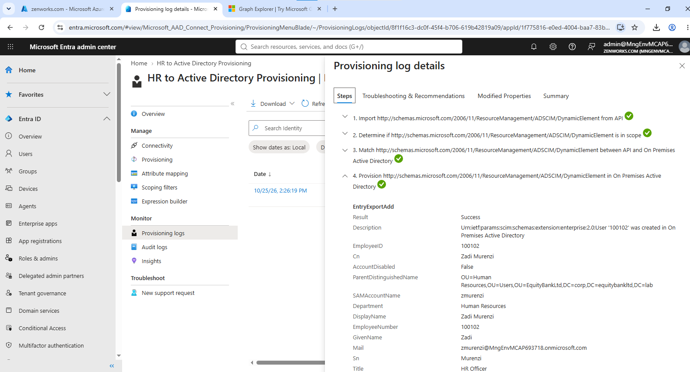

### Automating it: the HR file and the script

**9. App registration for the script.** HR Provisioning Connector, the app registration the script authenticates as. Single tenant (My organization only), one client secret and no certificates, state Activated.

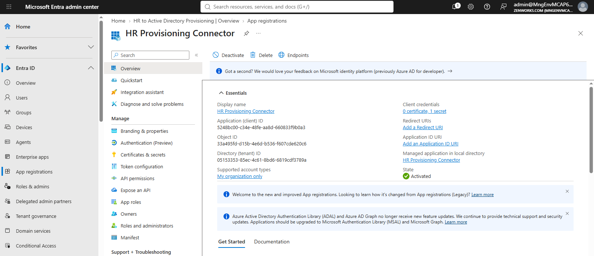

**10. The HR feed script.** C:\HRFeed holds hr_feed.csv and the hr-feed PowerShell script, shown in Notepad. The script's parameters are the tenant ID, the client ID and the provisioning API endpoint. The client secret is not stored in the file; the script prompts for it at run time with Read-Host.

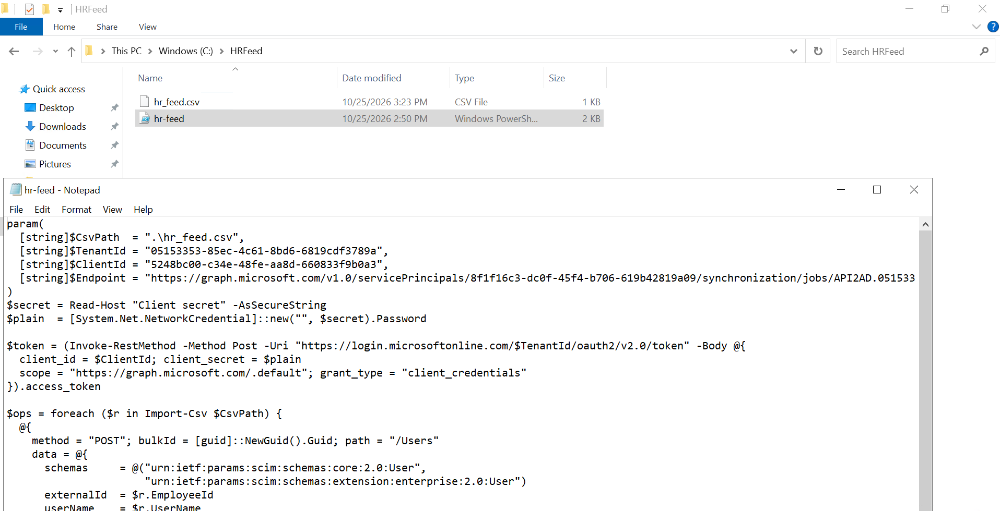

**11. Script run accepted.** Running .\hr-feed.ps1. The secret is entered masked, and the API returns Status 202 (Accepted), followed by the URL for tracking this run in the provisioning log.

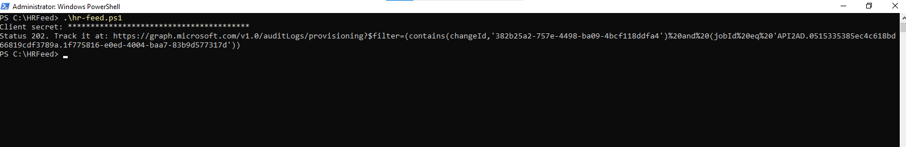

**12. All HR records in the provisioning log.** Every record the app processed, all Success. 2:26 PM: Zadi (100102) created from the single record. 2:58 PM: the script's first run created Noella (100103) and Julie (100104) and matched Zadi as an update instead of creating a duplicate. 3:15 PM: the second run updated all three, carrying Noella's move and Julie's departure.

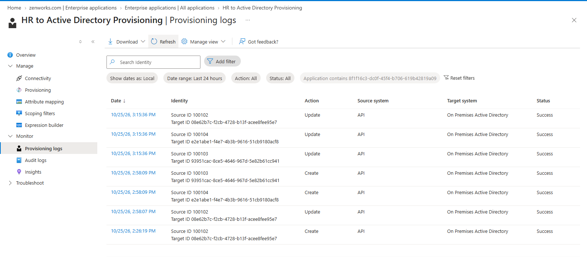

### Dynamic department groups

**13. Validating the Operations group rule.** The membership rule for the Operations Department dynamic group: department Operations, employee ID starting with 1001, and account enabled. Validation shows Noella Uwineza in the group and Ronald Ndatinya, who is in Finance, not in the group.

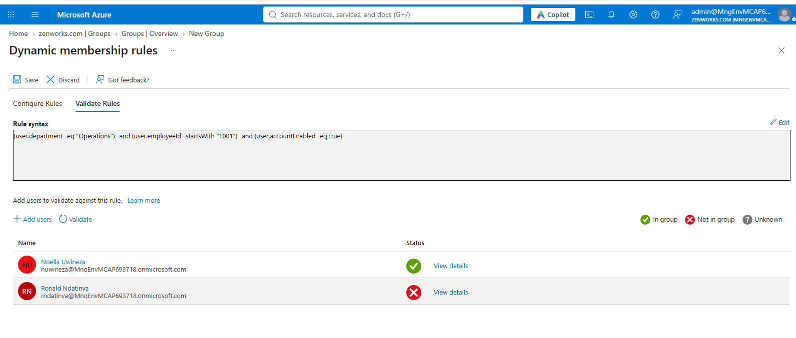

**14. Noella in the Operations group.** Noella's Microsoft Entra ID account, opened from the Operations Department member list (see the breadcrumb). Created at 3:02 PM, four minutes after the 2:58 PM script run created her in Active Directory, with 3 group memberships.

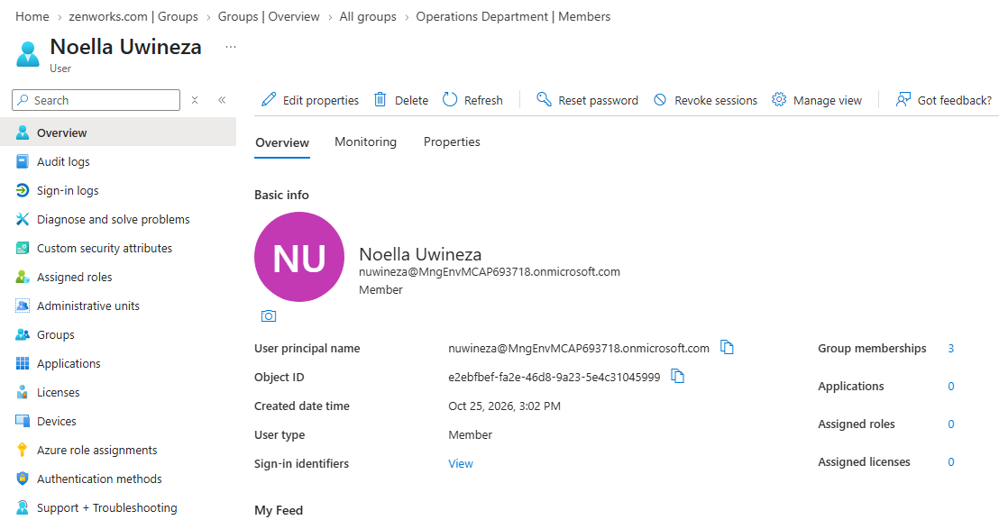

### The mover and the leaver

**15. HR file after the changes.** hr_feed.csv after two changes: Noella is now Financial Analyst in Finance (she started in Operations, screenshots 13 and 14), and Julie's status is Inactive. Zadi's row is unchanged.

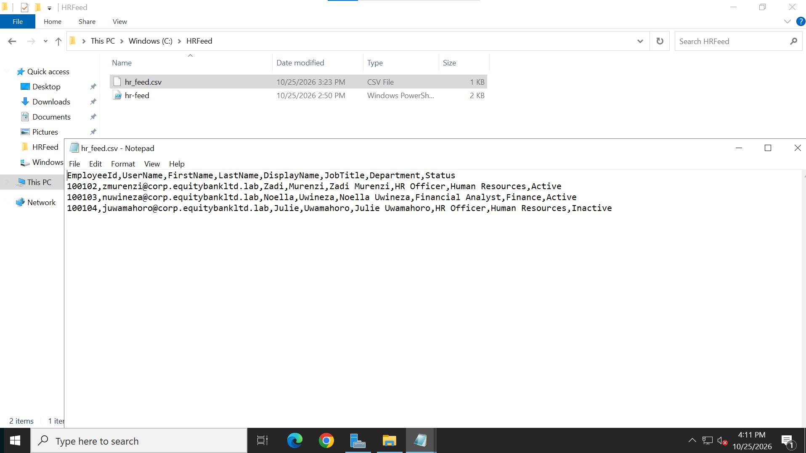

**16. Mover: Noella moved to Finance.** The provisioning log entry for Noella's 3:15:36 PM update. Modified properties: title Financial Analyst, department Finance, and parentDistinguishedName moved to the Finance OU. accountDisabled stays False because she is still employed.

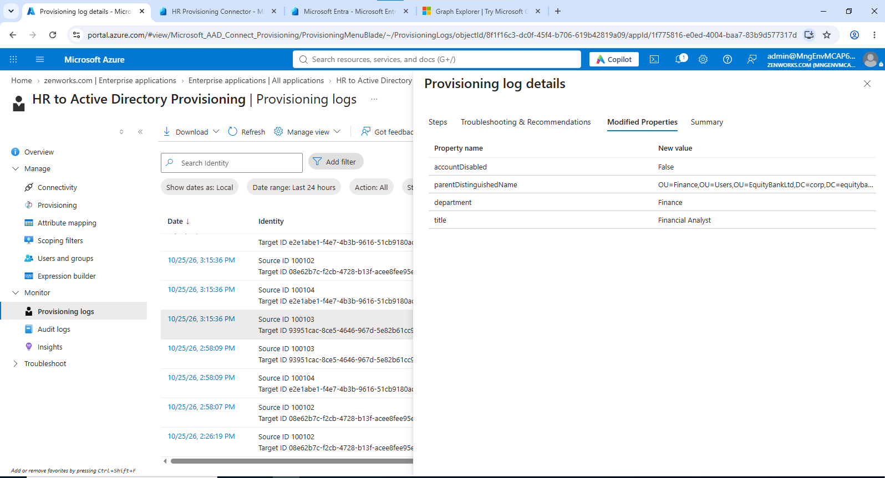

**17. Leaver: Julie disabled in Active Directory.** The Human Resources OU. Julie Uwamahoro's account shows the disabled icon; Zadi Murenzi's account is still active.

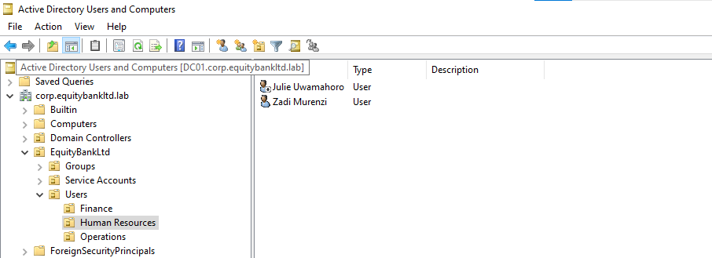

**18. Leaver: Julie removed from the HR group.** The HR Department group's audit log, 3:32 PM entry: Remove member from group, status success, initiated by the application Microsoft Approval Management rather than a user. The group's dynamic rule removed her once her account was disabled, 17 minutes after the 3:15 PM run.

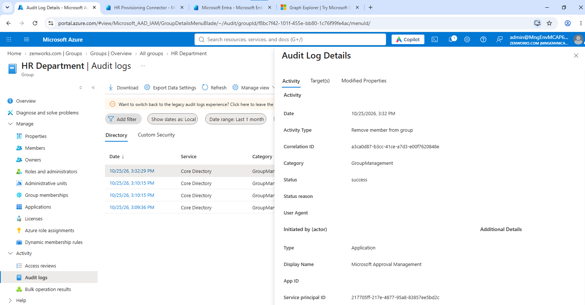

**19. Who was removed.** The Target(s) tab of the same entry: the user is juwamahoro (Julie), and the group ID matches the HR Department group ID in the address bar.

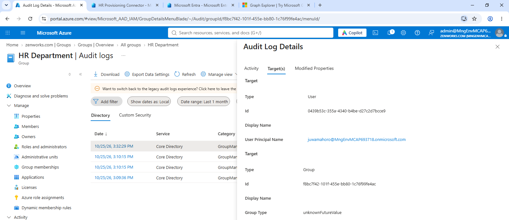

### Service and inactive account audit

**20. Service accounts and inactive accounts.** Three PowerShell checks on DC01, run on one line, so the output is merged into one list: service accounts, accounts with non-expiring passwords, and accounts inactive for 90 days. The only service account is provAgentgMSA (Enabled: True), the gMSA the sync agent runs under, so no one holds its password. The other rows are the built-in Guest (listed twice) and krbtgt accounts and the four lab staff, who have not signed in yet. In a bank, the inactive list would feed the quarterly access review.

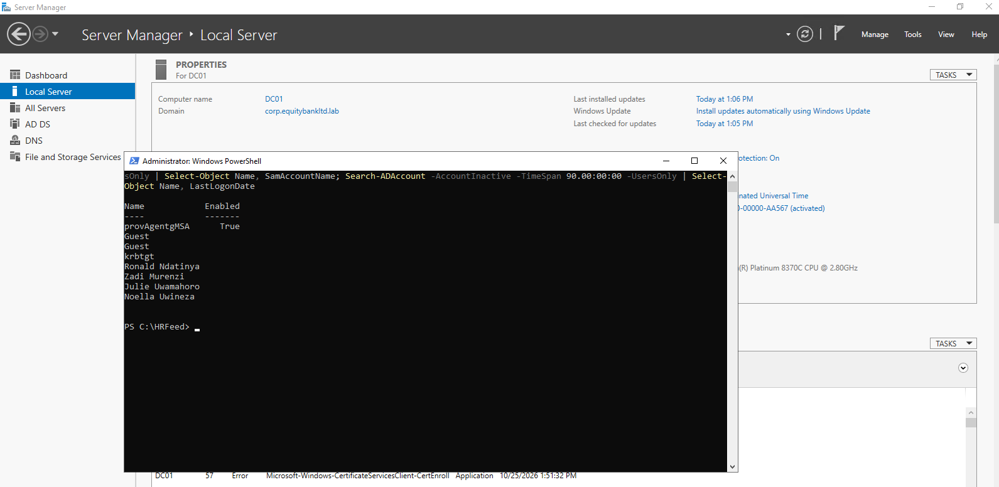
