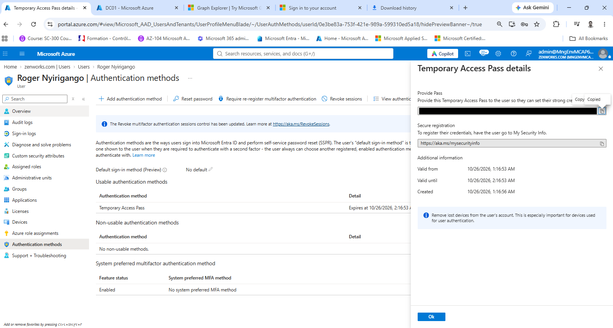
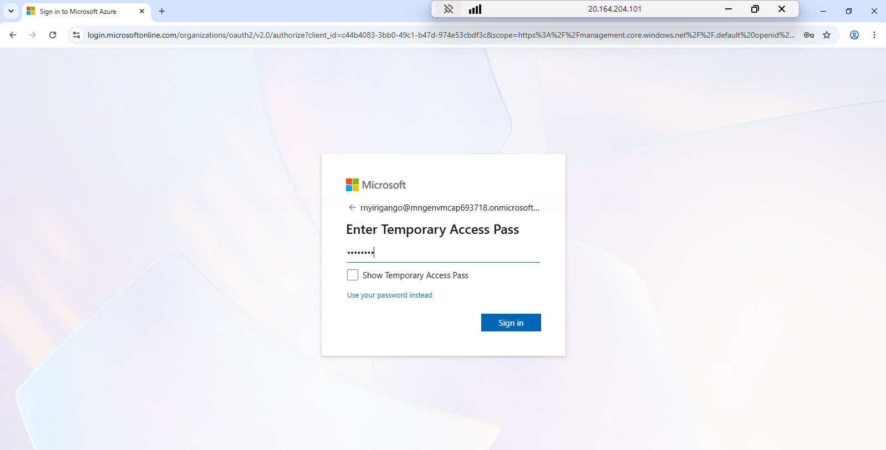
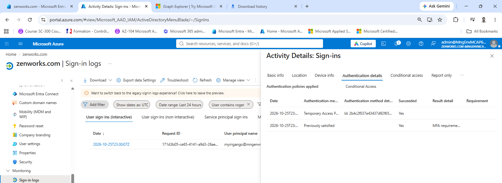
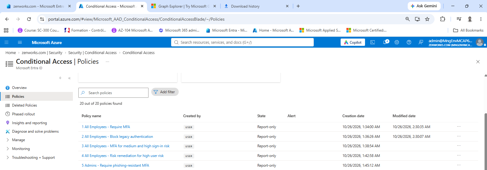
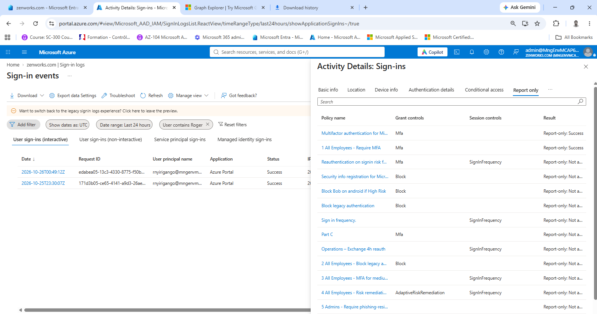
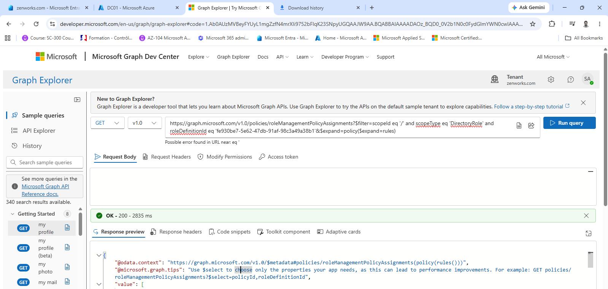
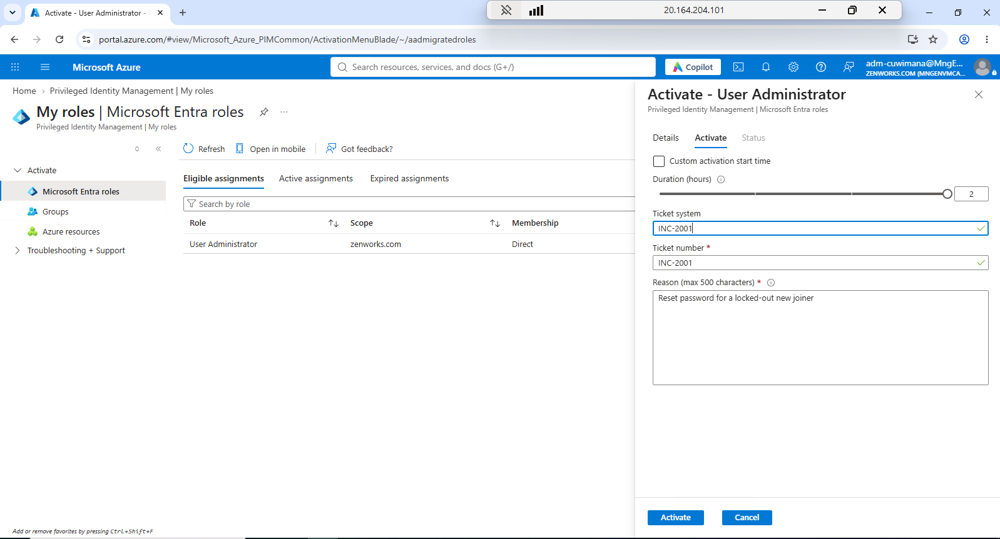
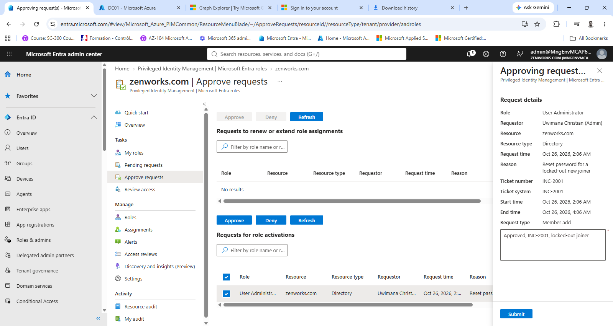
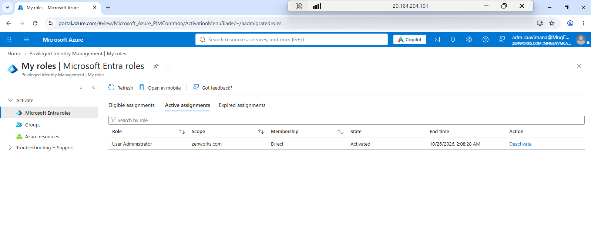
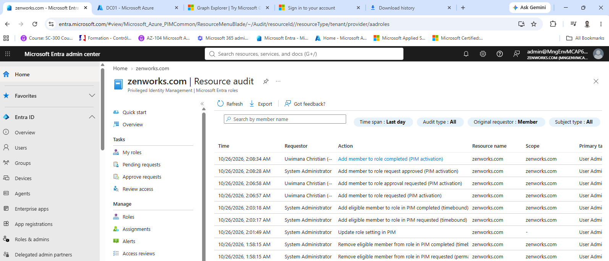

# Locking the front door (MFA, sign-in policies, admin rights on demand)

**The problem:** Stolen passwords are the most common way into a bank. Permanent admin rights turn one stolen admin password into a full breach.

**What I built:** New joiners start with a one-time Temporary Access Pass instead of a password. Five Conditional Access policies cover staff and admins: require MFA, block legacy sign-in, challenge risky sign-ins, make high-risk users secure their account, and require phishing-resistant MFA for admins. They run in report-only mode first, so their effect is measured before anyone is blocked. Admin rights are eligible only: User Administrator is switched on for two hours with MFA, a reason, a ticket number and someone else's approval, through Privileged Identity Management (PIM).

## The five sign-in policies

| Policy | What it does | State |
| --- | --- | --- |
| 1 All Employees - Require MFA | Every employee sign-in needs MFA | Report-only |
| 2 All Employees - Block legacy authentication | Blocks old sign-in protocols that can't do MFA | Report-only |
| 3 All Employees - MFA for medium and high sign-in risk | Asks for MFA again when a sign-in looks risky | Report-only |
| 4 All Employees - Risk remediation for high user risk | Makes a high-risk user secure their account | Report-only |
| 5 Admins - Require phishing-resistant MFA | Admin accounts must use phishing-resistant MFA | Report-only |

## Admin role rules (User Administrator)

| Rule | Setting |
| --- | --- |
| Longest activation | 2 hours |
| To activate | MFA, a justification, a ticket number, and approval by System Administrator |
| Eligible assignments | Expire after 180 days |
| Active assignments | Expire after 15 days |

## Results

- **Day one without a password:** Roger Nyirigango's first sign-in used a Temporary Access Pass valid for one hour, and the sign-in log shows it succeeded.
- **Policies tested before enforcement:** all five policies run in report-only mode, recording what they would do without blocking anyone. On Roger's sign-in at 2:49 AM, policy 1 would have succeeded and policies 2 to 5 would not have applied.
- **No standing admin rights:** the admin account is only eligible for User Administrator. Activating it took a reason, ticket INC-2001 and System Administrator's approval, and the role was set to end two hours later.
- **Every step on record:** the PIM audit log shows the request, the approval and the activation with who and when, and the role's rules are exported through Microsoft Graph.
- **Risk rules where Microsoft now wants them:** sign-in risk and user risk are handled by Conditional Access policies 3 and 4. Microsoft retired the legacy risk policies in ID Protection on 1 October 2026.

**Built with:** Microsoft Entra Conditional Access, Temporary Access Pass, Privileged Identity Management, Microsoft Graph.

## Files in this folder

| File | What it is |
| --- | --- |
| [pim-role-settings-user-administrator.json](pim-role-settings-user-administrator.json) | The Microsoft Graph response with every rule of the User Administrator role (screenshot 6) |

## Evidence, step by step

At most banks, a new joiner's first password is a risk, a password alone is not enough to sign in, and nobody keeps admin rights all day. In this lab, Roger Nyirigango, a new service desk analyst, signs in on day one with a one-time Temporary Access Pass instead of a password. Five Conditional Access policies run in report-only mode, so their effect can be checked before anyone is blocked. Admin rights are eligible, not permanent: the admin account switches on User Administrator for two hours, with a reason, a ticket number and someone else's approval. The work was done on 26 October 2026; times are local (UTC+2) unless a screenshot says UTC.

### Day one without a password

**1. A one-hour pass instead of a password.** Roger Nyirigango > Authentication methods, with the Temporary Access Pass details open. The pass is valid from 1:16:53 AM to 2:16:53 AM on 26 October 2026, one hour, and it is his only usable sign-in method, so there is no password to read out or email. The pass itself is blacked out here.

**2. Roger's first sign-in asks for the pass.** Signing in as rnyirigango, Microsoft asks for the Temporary Access Pass, not a password. The pass is typed in and hidden by dots.

**3. The sign-in log records the pass.** Sign-in logs filtered on roger, dates shown in UTC: one sign-in at 2026-10-25T23:30:07Z, which is 1:30 AM on 26 October local time, inside the pass's one-hour window. Authentication details: Temporary Access Pass, succeeded. The second row shows the MFA requirement as previously satisfied.

### Sign-in policies, tested before they block anyone

**4. Five Conditional Access policies in report-only.** Conditional Access > Policies. The tenant has 20 policies; these are this project's five, all in Report-only and created between 1:34 and 1:45 AM on 26 October: 1 All Employees - Require MFA, 2 All Employees - Block legacy authentication, 3 All Employees - MFA for medium and high sign-in risk, 4 All Employees - Risk remediation for high user risk, and 5 Admins - Require phishing-resistant MFA. Policies 1 and 2 were last edited at 2:30 AM.

**5. What the policies would have done to Roger's sign-in.** Sign-in logs filtered on Roger, dates in UTC: a second sign-in at 2026-10-26T00:49:12Z (2:49 AM local), to Azure Portal, status Success, made after the five policies existed. Its Report only tab lists every report-only policy in the tenant with the result it would have had. 1 All Employees - Require MFA shows Report-only: Success, so the MFA it asks for was met. Policies 2, 3, 4 and 5 show Report-only: Not applied (cut off as "Not a..."), as expected: the sign-in used a browser, carried no risk, and Roger is not an admin. The other rows are other admins' policies in the same tenant.

### Admin rights for two hours, with approval

**6. The role's rules, read through Microsoft Graph.** Graph Explorer, GET on roleManagementPolicyAssignments for User Administrator (role ID fe930be7-5e62-47db-91af-98c3a49a38b1 in the query), with the policy and its rules expanded: 200 OK. The full response is saved as pim-role-settings-user-administrator.json. It shows that activation lasts at most 2 hours (PT2H) and needs MFA, a justification, a ticket and approval by System Administrator; eligible assignments expire after 180 days and active ones after 15 days. The policy was last changed at 00:01:48 UTC, 2:01 AM local, the same minute as the "Update role setting in PIM" entry in screenshot 10.

**7. The admin account asks for the role.** Signed in as adm-cuwimana: PIM > My roles > Microsoft Entra roles. User Administrator is listed under Eligible assignments (scope zenworks.com, membership Direct), so it is not active until asked for. The Activate panel: duration 2 hours, ticket number INC-2001, reason "Reset password for a locked-out new joiner".

**8. Someone else approves it.** Signed in as admin@, the System Administrator account: PIM > Approve requests. Under Requests for role activations, one request: User Administrator, requested by Uwimana Christian (Admin). The details show the request time (Oct 26, 2026, 2:06 AM), the reason, ticket INC-2001, and a start and end time of 2:06 AM to 4:06 AM, two hours. The approver has typed the justification "Approved, INC-2001, locked-out joiner" before Submit.

**9. The role is active, with an end time.** Back as adm-cuwimana: My roles > Active assignments shows User Administrator, state Activated, end time 10/26/2026, 2:08:28 AM. This screenshot was taken on the lab VM, which runs on UTC: 2:08:28 AM UTC is 4:08:28 AM local time, exactly two hours after the approval logged at 2:08:28 AM local time in screenshot 10.

**10. Every step in the audit log.** PIM > Microsoft Entra roles > Resource audit, last day. The top four rows, read from the bottom up: at 2:06:57 AM Uwimana Christian (Admin) requests the role, at 2:06:58 approval is requested, at 2:08:28 System Administrator approves, and at 2:08:34 the activation completes. The rows below show the setup: an eligible assignment removed at 1:58 AM, the role settings updated at 2:01 AM, and a time-bound eligible assignment added at 2:03 AM.

