# Third-party access (external auditors)

**The problem:** Banks let outsiders in all the time: external auditors, consultants, vendors. Guest accounts are created by hand for a project and never removed, so a year later nobody knows who they are, who approved them, or why they can still sign in.

**What I built:** An access package for outsiders in Microsoft Entra ID Governance. An external auditor follows a link, signs in with their own email and asks for access, giving their audit firm and engagement reference. The Head of Internal Audit approves or denies it, with a reason. On approval, Entra creates the guest account and adds it to one group, Audit Evidence - External Readers, for 30 days. A monthly guest review asks Internal Audit whether each outsider still needs access; a denied guest is blocked from signing in and queued for removal from the tenant.

| Setting | Value |
| --- | --- |
| Catalog | Third-Party Access, enabled for external users |
| Who can ask | People outside the directory: all connected organizations and any new external user |
| Questions | Audit firm name and Engagement reference, both required, plus a business justification |
| Approval | One stage: Mukamana Grace, Head of Internal Audit, within 3 days, with a written reason |
| Access granted | Member of Audit Evidence - External Readers |
| Ends | After 30 days; an extension needs approval again |
| Reviews | Monthly, by Mukamana Grace, with a reason for each decision; a denied guest is blocked, then removed from the tenant |
| Guest lifecycle | A guest who loses their last access package is blocked from signing in at once and deleted after 30 days |
| Tenant settings | Guests see only their own directory object; only admin roles can invite guests; no self-service sign-up |

## Results

- **In without an IT ticket:** the auditor asked at 3:03 AM from outside the bank, naming the firm (Ndayisaba & Partners) and the engagement (AUD-2026-014). Mukamana Grace approved at 3:14 AM with the reason "Engagement letter AUD-2026-014 is on file", and the guest account, group membership and welcome email followed the same minute.
- **Access that ends by itself:** the assignment ends on 26 November 2026, 30 days after approval, and the auditor's email states the 30 days.
- **Shut off by a review, with the reason on record:** at the monthly guest review Grace denied further access ("Fieldwork finished; engagement AUD-2026-014 closed"), and the review blocked the guest from signing in ("waiting to be removed from the tenant"); the account now shows Account enabled: No.
- **Every outsider accounted for:** the guest inventory, from the portal and from Microsoft Graph, lists all five guests in the tenant with company, state and whether they can sign in. It also shows an invitation pending since June that nobody accepted.

**Built with:** Microsoft Entra ID Governance entitlement management (catalog, access package for external users, approval, expiry), access reviews of guests, Microsoft Entra External ID (B2B collaboration, email one-time passcode), My Access, Microsoft Graph.

## Files in this folder

| File | What it is |
| --- | --- |
| [guest-inventory.md](guest-inventory.md) | The Microsoft Graph query that lists every guest, and its result |

## Evidence, step by step

At most banks, external auditors need to see audit evidence for a few weeks, and their accounts tend to outlive the engagement. In this lab, an auditor from Ndayisaba & Partners asks for access from outside the bank, with no account in its directory. Mukamana Grace, Head of Internal Audit, approves the request. Microsoft Entra then creates the auditor's guest account, adds it to Audit Evidence - External Readers and sets the access to end after 30 days. At the monthly guest review Grace denies further access, and the guest account is blocked from signing in. The auditor is played by a personal Gmail account, display name magie chris. Everything happened on 27 October 2026; My Access on the lab VM shows GMT, and the portal, Gmail and the auditor's browser show local time (UTC+2).

### Tenant settings for guests (read, not changed)

**1. Guests see only their own account, and few people can invite.** External Identities > External collaboration settings, tenant-wide. Guest user access: "Guest user access is restricted to properties and memberships of their own directory objects (most restrictive)". Guest invite restrictions: "Only users assigned to specific admin roles can invite guest users". Enable guest self-service sign up via user flows: No. So no ordinary employee can invite an outsider; outsiders come in through the access package instead.

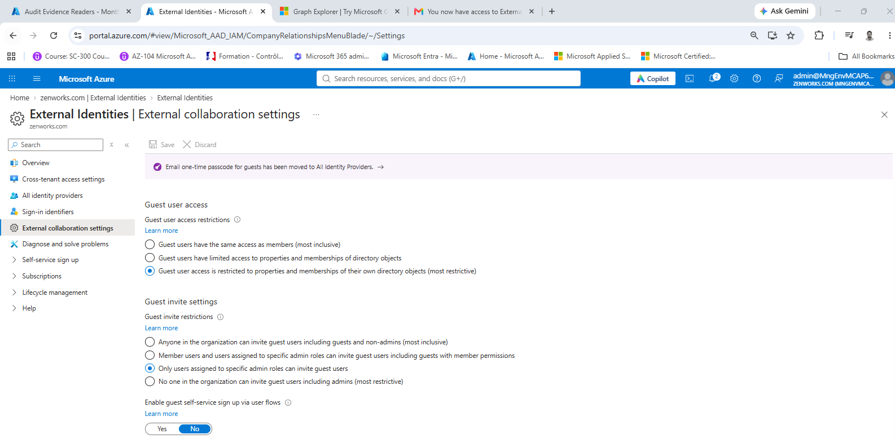

**2. No domain is blocked.** The same page scrolled down. External user leave settings: Allow external users to remove themselves from your organization, Yes. Collaboration restrictions: "Allow invitations to be sent to any domain (most inclusive)", so the auditor's gmail.com address can be invited.

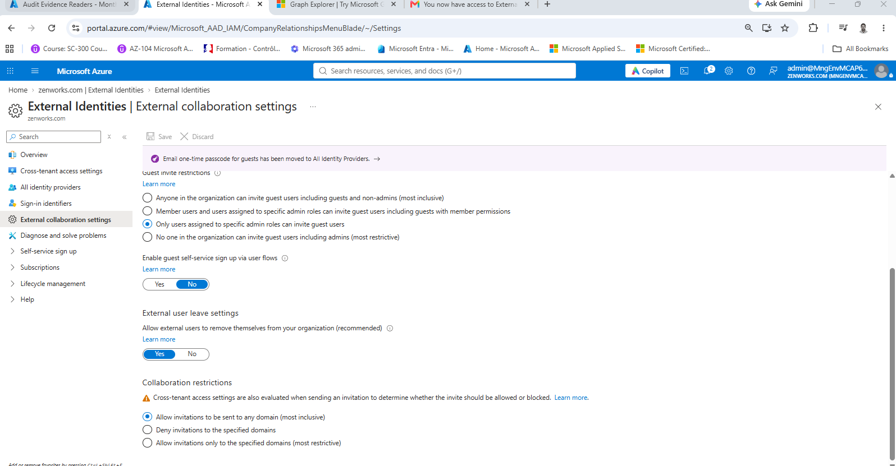

**3. Outsiders are blocked, then removed, when their access ends.** Identity Governance > Control configurations > Lifecycle of external users (Enabled): "These settings determine what happens when an external user, who was added to your directory through an access package request, loses their last assignment to any access package." Remove external user: ticked. Block external user from signing in to directory: ticked. Number of days before removing external user from directory: 30. So a guest who loses their last access package is blocked straight away and deleted 30 days later.

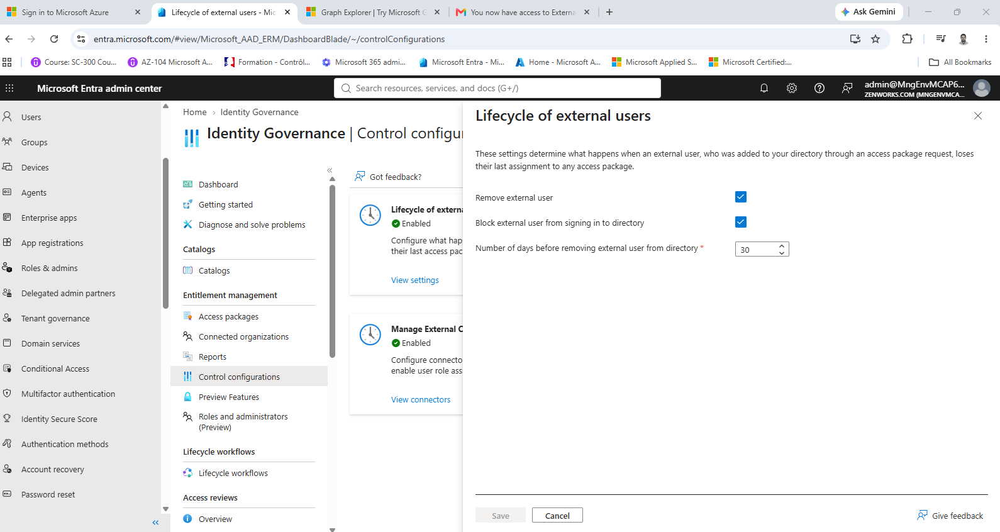

### The access package

**4. Who can ask, and on what terms.** Identity Governance > Access packages > External Audit Access > Policies > Initial Policy: Enabled Yes. Users who can request access: All users (All connected organizations + any new external users). Who can request access: Admin, Self. Require approval Yes, Require requestor justification Yes, How many stages 1. Questions: Audit firm name + 1 more. Expiration: Assignments expire after 30 days. Require access reviews: Yes. Active assignments: 1.

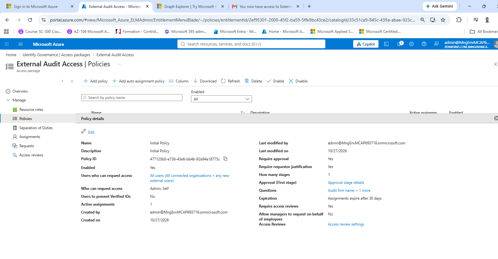

### The auditor asks, Internal Audit approves

**5. The request reaches Mukamana Grace.** My Access on the lab VM, signed in as Mukamana Grace: Approvals, 1 pending. magie chris (magiechris96@gmail.com) asked for External Audit Access on Oct 27, 2026, 1:03 AM GMT (3:03 AM local); it is due by Oct 30, 2026, 1:03 AM GMT, three days later. The Access request panel shows the request and the decision still to make: Approve or Deny, with a reason required.

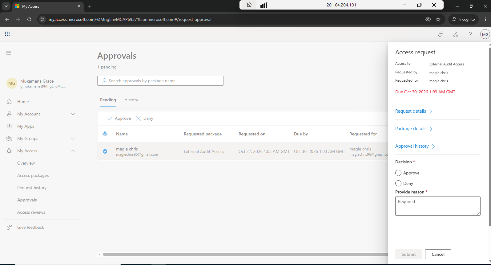

**6. The auditor names the firm and the engagement.** My Access on the lab VM as Mukamana Grace, Approvals > History: 1 completed approval, magie chris (External Auditor), External Audit Access, decision Approved, by Mukamana Grace. The request's details: submitted Oct 27, 2026, 1:03 AM GMT; Audit firm name Ndayisaba & Partners; Engagement reference AUD-2026-014; Business justification "Annual external audit fieldwork 2026"; access asked for: the group Audit Evidence - External Readers, role Member.

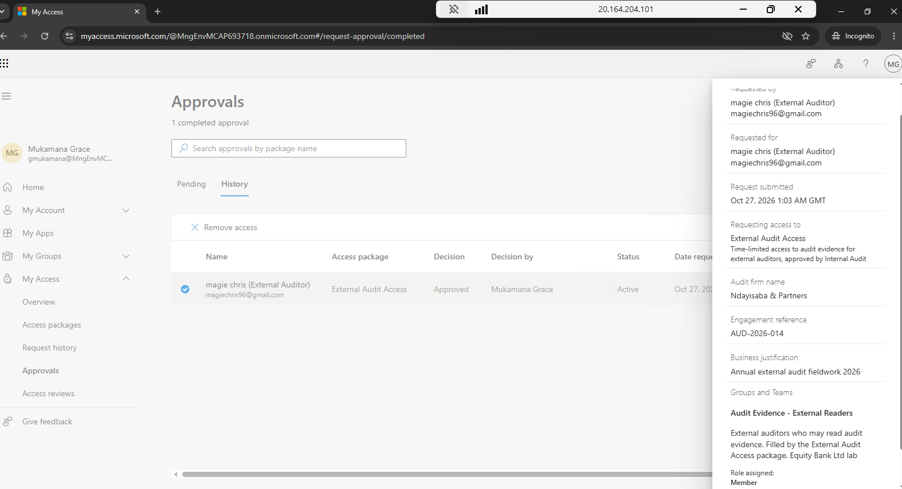

**7. Grace approves, and says why.** The same request's history: the auditor's request at 1:03 AM GMT, then "Mukamana Grace approved" on Oct 27, 2026, 1:14 AM GMT (3:14 AM local). Approved by Mukamana Grace, reason "Engagement letter AUD-2026-014 is on file", the same reference the auditor gave.

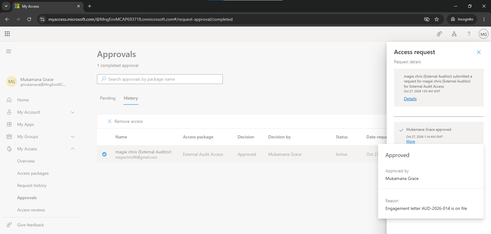

**8. From request to access in eleven minutes.** My Access as the auditor, magie chris (magiechris96@gmail.com): Request history, one request for External Audit Access, status Delivered. The timeline, in local time (+02): submitted by magie chris at 3:03 AM, pending approval at 3:03 AM, Mukamana Grace approved at 3:14 AM, then delivering, access delivered and delivered notification sent, all at 3:14 AM.

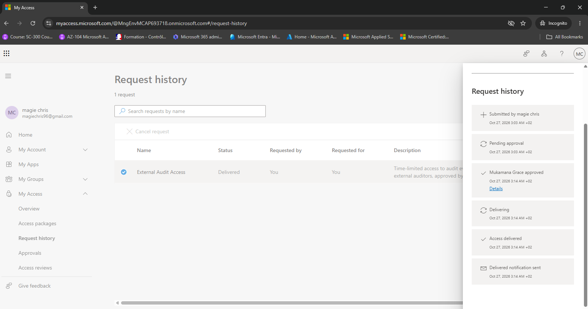

**9. The auditor is told how long access lasts.** The auditor's Gmail inbox at 3:14 AM local: "You now have access to External Audit Access" from Microsoft Security (MSSecurity-noreply@microsoft.com), with zenworks.com at the top: "You've received access to External Audit Access". Access start date: Now. Access end date: 30 days.

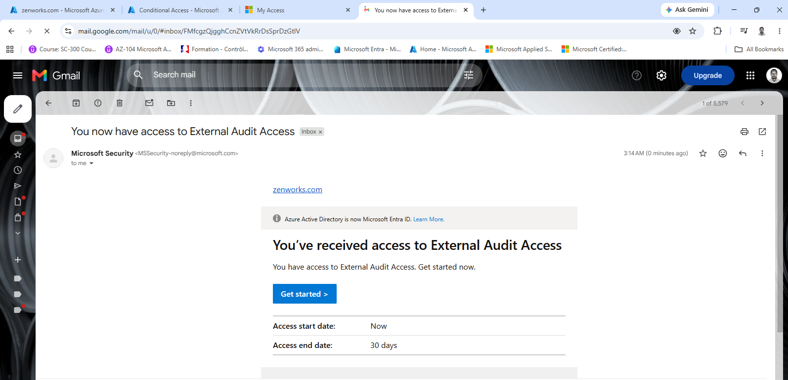

**10. The guest lands in one group only.** Groups > Audit Evidence - External Readers > Members: 1 group member found, magie chris, magiechris96@gmail.com, User type Guest, Object Id 0f3736a1-05f7-4c65-97b2-c9587a4cf242. The group is the access package's only resource, and the package added the guest when the request was approved.

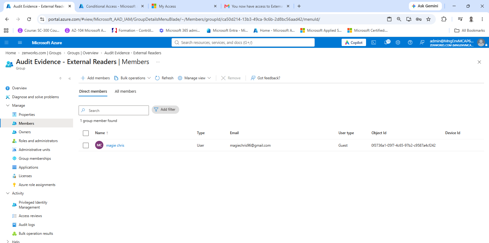

**11. The assignment has an end date.** Identity Governance > Access packages > External Audit Access > Assignments: magie chris, user principal name magiechris96_gmail.com#EXT#@MngEn... (a guest), policy Initial Policy, status Delivered, End date 11/26/2026, 3:14:19 AM, 30 days after the approval. User lifecycle: Governed, so the guest account itself is managed by entitlement management, not left behind.

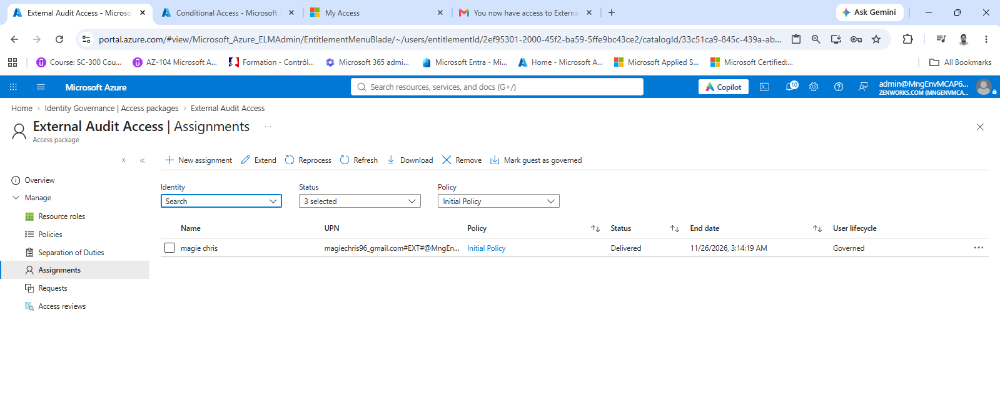

### Access shut off, and every guest accounted for

**12. Grace denies further access at the monthly review.** My Access on the lab VM, signed in as Mukamana Grace: Audit Evidence Readers - Monthly guest review, "Please review assignment to 'Audit Evidence - External Readers'". The system recommends Deny for magie chris (External Auditor), marked Inactive user. The panel: Denied by Mukamana Grace on Oct 27, 2026, 1:34 AM GMT (3:34 AM local), reason "Fieldwork finished; engagement AUD-2026-014 closed".

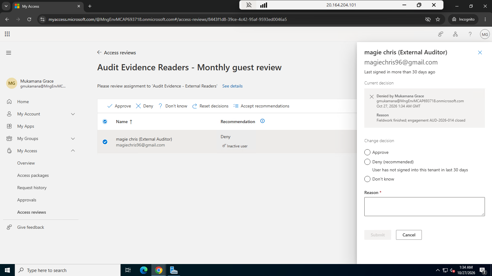

**13. The review blocks the guest and queues its removal.** Access reviews > Audit Evidence Readers - Monthly guest review > Review history > Access review details > Results. Status: Applied by Access Reviews, Applied Date 10/27/2026. magie chris (External A...): outcome Denied, recommended action Deny, reviewed by Mukamana Grace (gmukamana@MngEnvMCAP6937...) on 10/27/2026, apply result Success, "Blocked from signing-in, waiting to be removed from the tenant." The account can no longer be used, and the guest will be deleted from the directory.

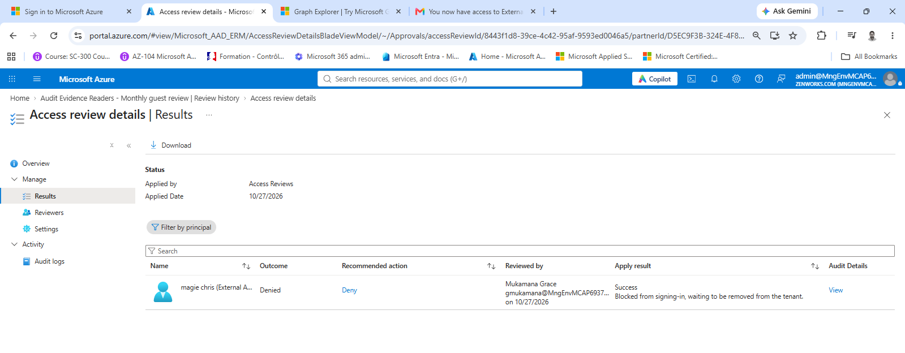

**14. Guest inventory: the auditor is blocked.** Microsoft Entra ID > Users, filtered on User type == Guest: 5 users found. magie chris (External Auditor): Company name Ndayisaba & Partners, Creation type Invitation, Account enabled No, blocked after Grace's denial. The other four guests belong to earlier work in this shared lab tenant and can still sign in (Account enabled Yes); their addresses are blacked out here.

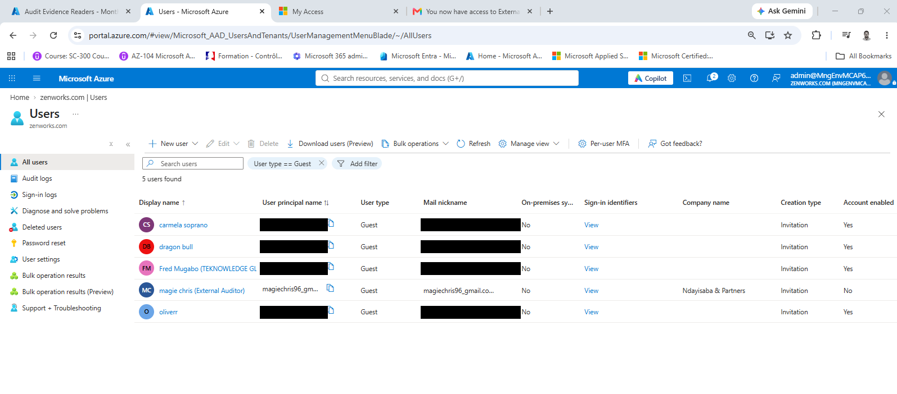

**15. The same inventory through Microsoft Graph.** Graph Explorer, GET users?$filter=userType eq 'Guest' with displayName, mail, companyName, createdDateTime, externalUserState and accountEnabled: 200 OK. The auditor's entry: createdDateTime 2026-10-27T01:14:24Z (3:14 AM local, the minute Grace approved), externalUserState Accepted, accountEnabled false. The query and the full result are in guest-inventory.md. The one-time sign-in code in the address bar is blacked out.

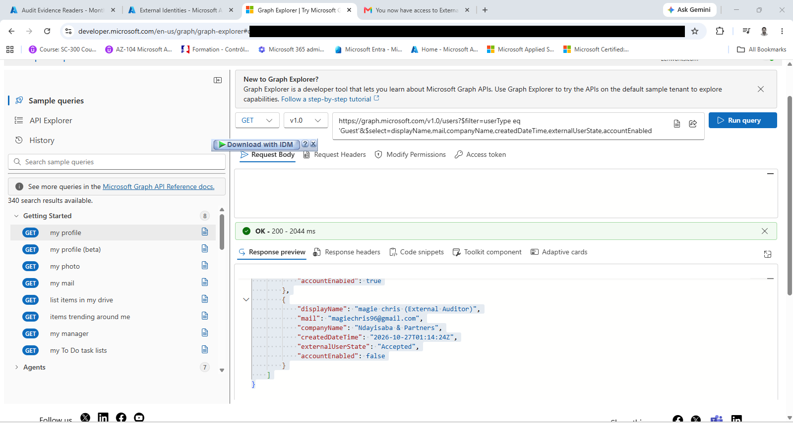
