# Two people for every payment (maker-checker access)

**The problem:** In payments, the person who keys a payment must never be the one who releases it. Auditors test this control first, and spreadsheets of who holds which role go stale.

**What I built:** The two payment roles, Payment Initiation (maker) and Payment Approval (checker), are access packages in Microsoft Entra ID Governance. Only members of Payments Team can request them; it is a dynamic group whose rule takes everyone with an employee ID starting 1002 and an enabled account. Every request needs two approvals, each within 3 days and with a written reason: the requester's manager first, then a second approver from outside their line. Access expires after 90 days, an extension needs approval again, and the person's manager reviews it every quarter. Anyone who already holds one role is refused the other.

## Who can do what

| Role | Who holds it | Can request | First approver | Second approver | Expires | Cannot be combined with |
| --- | --- | --- | --- | --- | --- | --- |
| Payments Officer (maker) | Bush David, Fleury Ubaruta | Payment Initiation | Their manager, Boris Ntwari | Nyirabizimana Berthe | 90 days | Payment Approval |
| Payments Supervisor (checker) | Hategekimana Emmanuel, Clement Munyaneza | Payment Approval | Their manager, Nyirabizimana Berthe | Boris Ntwari | 90 days | Payment Initiation |
| Head of Payment Operations | Nyirabizimana Berthe | Nothing; approves | | | | |
| Head of Institutional Banking | Boris Ntwari | Nothing; approves | | | | |

The second approver is never the first, so every grant carries two different names.

## Results

- **Two approvers on every grant:** Bush David's request for Payment Initiation was approved by his manager, Boris Ntwari, at 6:53 PM and by Nyirabizimana Berthe at 6:58 PM GMT, and delivered the same minute.
- **Access that ends on its own:** his assignment runs from 25 October 2026 to 23 January 2027, 90 days, with nobody having to remember to remove it.
- **Blocked, not just flagged:** when Bush then asked for Payment Approval, My Access refused and named Payment Initiation as the conflict. No request was created, and Payment Approval has no assignments.
- **Ready for the auditor:** both packages' assignments are exported below, and the rule can be checked through Microsoft Graph.

**Built with:** Microsoft Entra ID Governance entitlement management (access packages, two-stage approval, separation of duties), dynamic groups, My Access and Microsoft Graph.

## Files in this folder

| File | What it is |
| --- | --- |
| [Payment_Initiation_Assignments_2026-10-25.csv](Payment_Initiation_Assignments_2026-10-25.csv) | Who holds Payment Initiation, from when and until when, exported from the portal |
| [Payment_Approval_Assignments_2026-10-25.csv](Payment_Approval_Assignments_2026-10-25.csv) | The same export for Payment Approval: no one holds it |
| [graph-query.md](graph-query.md) | The Microsoft Graph query that lists the incompatible package, and its result |

## Evidence, step by step

At most banks, the person who keys a payment must never be the one who releases it. In this lab, payment access is requested in My Access, needs two approvals from two different people, and expires after 90 days, and anyone who already holds one payment role is refused the other. The screenshots below show the setup, then one test: Bush David, a payments officer, asks to key payments, gets both approvals, then asks to release payments as well and is blocked. The test was run on 25 October 2026; My Access shows times in GMT.

### The payments team

**1. Payments Team fills itself.** Payments Team is a dynamic group, so its members come from a rule, not from manual adds. Validating the rule against the six payments staff returns In group for all six: Boris Ntwari, Bush David, Clement Munyaneza, Fleury Ubaruta, Hategekimana Emmanuel and Nyirabizimana Berthe. It is the only group allowed to request the two payment roles.

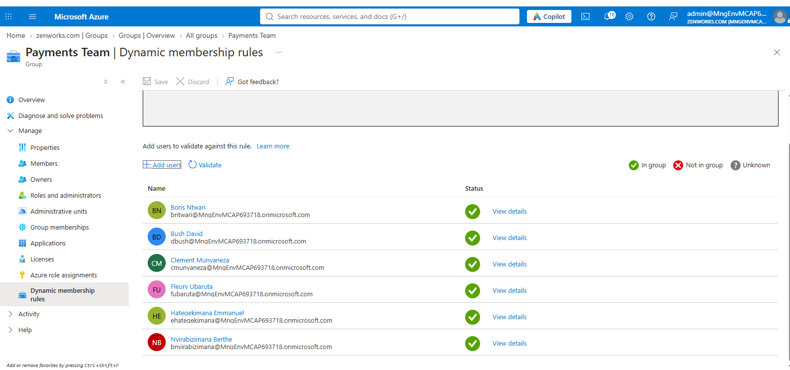

**2. Boris Ntwari's team: the payments officers.** All users filtered on Manager == Boris Ntwari: Bush David and Fleury Ubaruta. They key payments, so Boris, as their manager, is the first approver on their requests.

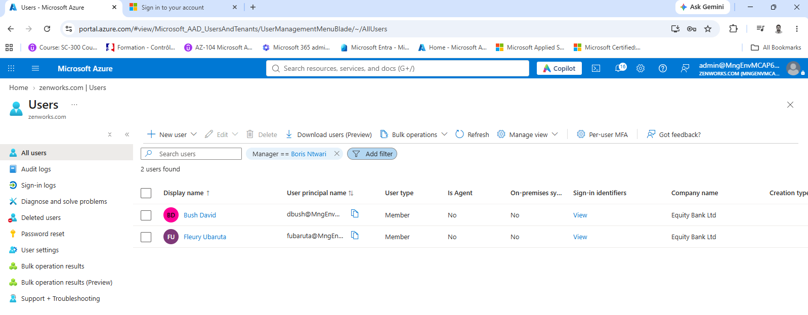

### How the two roles are set up

**3. Payment Initiation: two approval stages.** Edit policy for Payment Initiation (see the breadcrumb), Requests tab, scrolled to the approval settings. Approval is required, in 2 stages. First Approver: Manager as approver, with Uwimana Christian (Admin) as fallback. Second Approver: the specific approver Nyirabizimana Berthe. Each stage has 3 days to decide, and both approvers must give a justification.

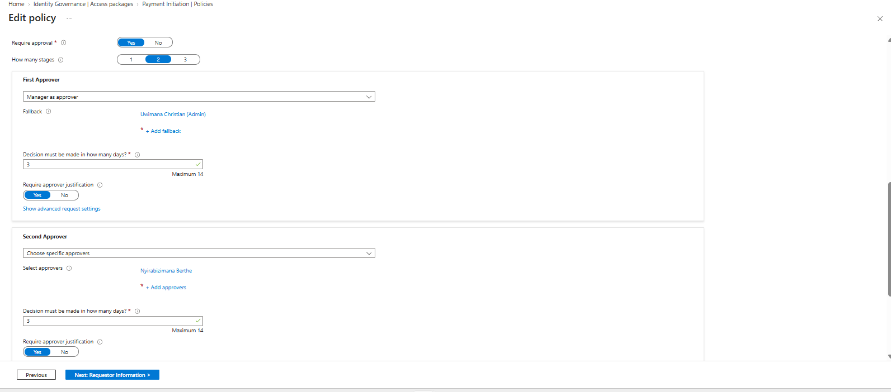

**4. Payment Initiation: 90-day expiry and quarterly review.** The Lifecycle tab of the same policy. Assignments expire after 90 days, and users cannot choose their own timeline. Users can ask to extend, but an extension needs approval. Access reviews are required: every quarter starting 10/25/2026, 7 days each, carried out by the user's manager, with Uwimana Christian (Admin) as fallback reviewer.

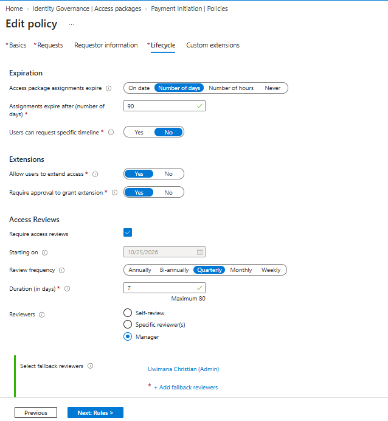

**5. Payment Approval: a different second approver.** The same Requests tab for Payment Approval (see the breadcrumb). Again 2 stages, with Manager as approver first (fallback Uwimana Christian (Admin)), but here the second approver is Boris Ntwari. Each stage has 3 days, with justification required. Payment Approval's Lifecycle tab has the same settings as screenshot 4.

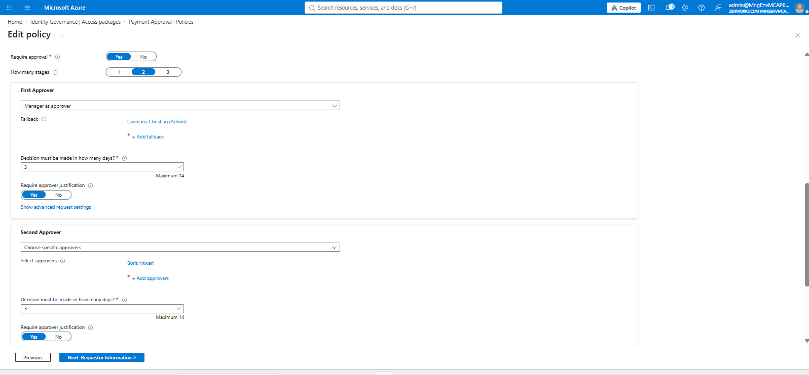

### One request, two approvers

**6. Bush's request reaches his manager.** Bush David requested Payment Initiation at 6:43 PM GMT. Signed in as Boris Ntwari, his manager, Approvals shows that one pending request, due by Oct 28, 2026. The decision panel is open, and a reason is required before Approve or Deny can be submitted.

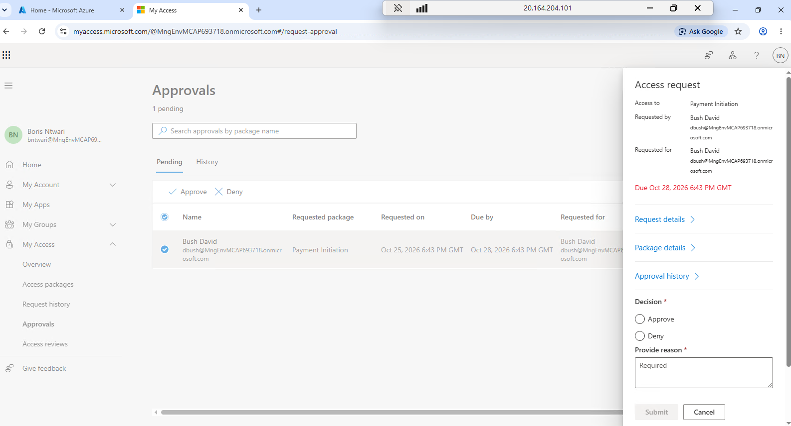

**7. Access delivered after two approvals.** Bush's Request history shows Payment Initiation as Delivered. The timeline records each step: Boris Ntwari approved as first approver at 6:53 PM; the request then waited at Pending approval for the second stage; Nyirabizimana Berthe approved as second approver at 6:58 PM, and access was delivered at 6:58 PM GMT. Two different people signed off, and both are named in the record.

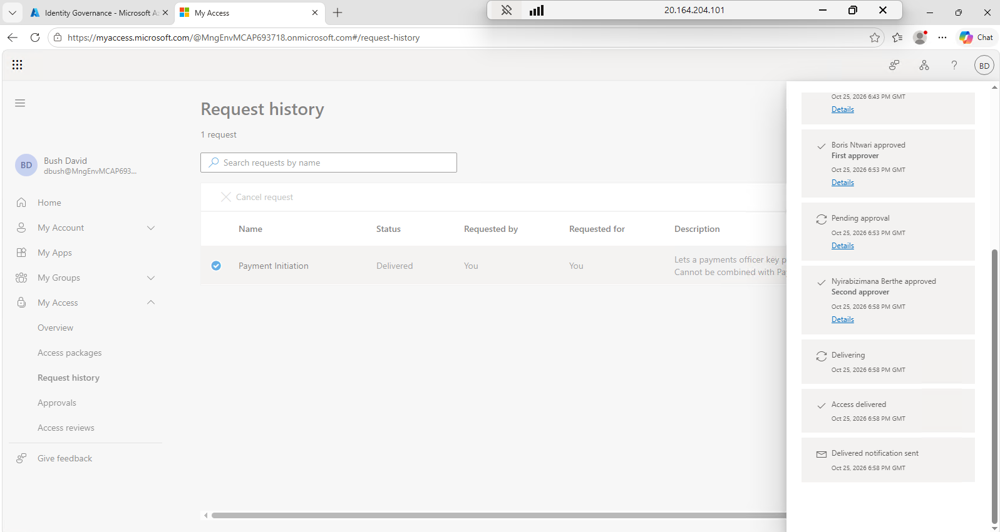

### Asking for both roles is blocked

**8. Bush asks for Payment Approval and is refused.** Bush David, still signed in, opens Payment Approval. My Access refuses: "You cannot request access as you currently have incompatible group membership(s) and/or access package assignment(s)". See details names the conflict, Payment Initiation, and Continue is greyed out, so the request cannot be submitted.

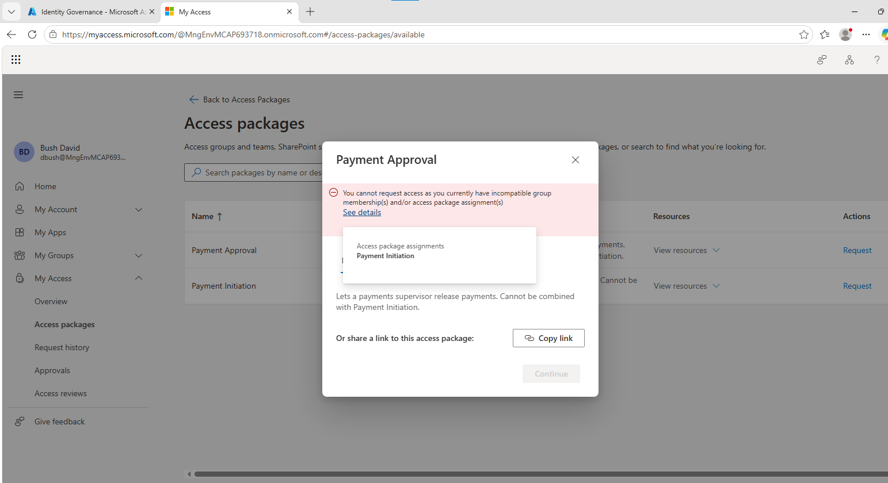

**9. The separation-of-duties setting.** Payment Approval > Separation of Duties, Incompatible access packages tab: Payment Initiation is listed, object ID 70ef6263-0d8f-4f11-8fcf-1129848dedc0. This is the setting that refused Bush's request in screenshot 8: anyone who holds Payment Initiation cannot get Payment Approval.

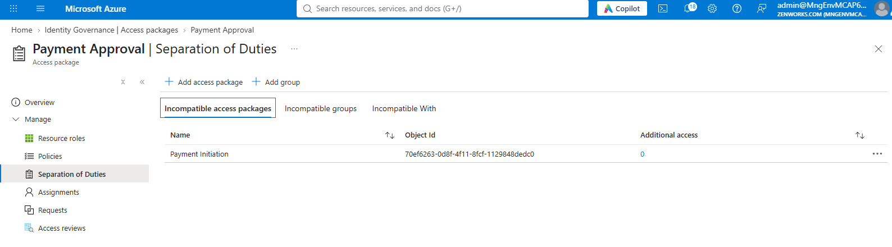

**10. The same rule from the other side.** Payment Initiation > Separation of Duties, Incompatible access packages tab: Payment Approval is listed, object ID 7cbf6801-3076-44fd-910c-58cd33227819, the same ID used in the Graph query (screenshot 11). With screenshot 9, the rule is set both ways: holding either payment role blocks a request for the other.

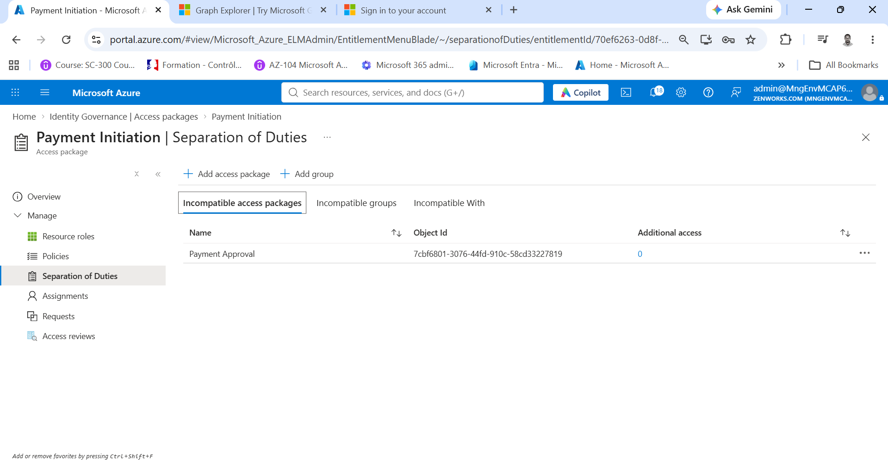

**11. The rule, confirmed through Microsoft Graph.** Graph Explorer, GET on incompatibleAccessPackages for Payment Approval (its ID, 7cbf6801-3076-44fd-910c-58cd33227819, is in the query), selecting displayName and description. The response (200 OK) returns one package, Payment Initiation: "Lets a payments officer key payments. Cannot be combined with Payment Approval." This matches the portal setting in screenshot 9.

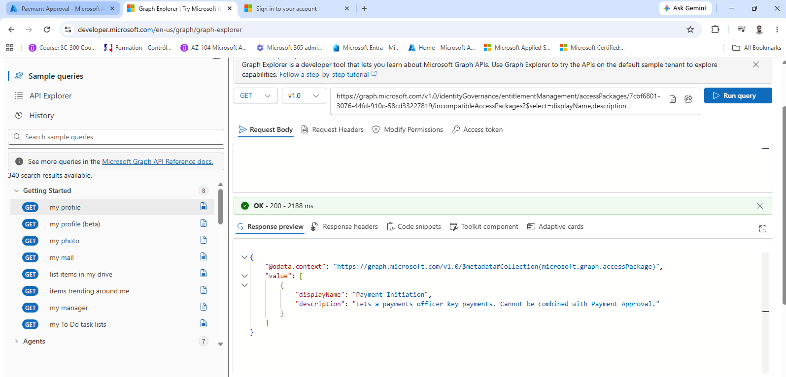

### Where things stand

**12. One role held, the other untouched.** Identity Governance > Access packages at the end of the test. Payment Initiation and Payment Approval are both in the Payments catalog. Payment Initiation has one active assignment (Bush David's, per the assignment export); Payment Approval has none, and neither has pending requests. Medical Project Users is from another lab in the same tenant and is not part of this project.

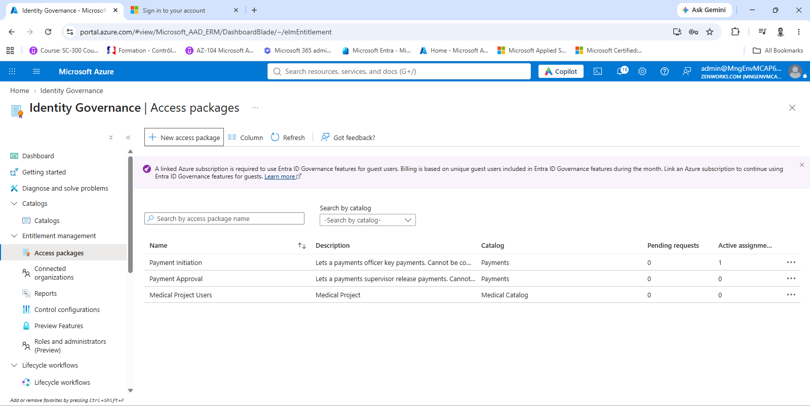

**13. Bush David is in the initiators group.** Payments System - Initiators > Members, Direct members: 1 group member found, Bush David (User, Member). This is the group the Payment Initiation package grants. His object ID, 03aa36ff-8011-4a88-9ed8-f42efcc1cca8, matches the User Id in the Payment Initiation assignment export.

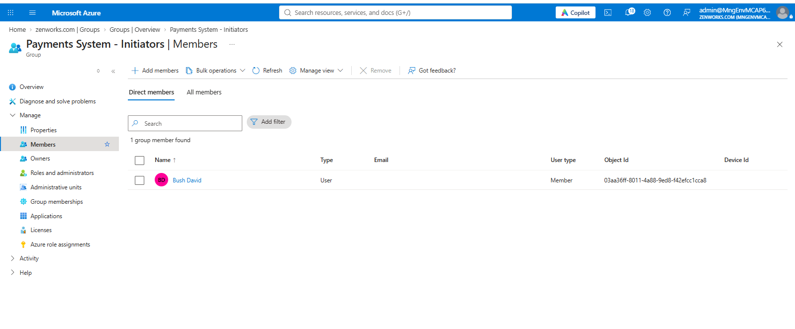
