# Watching and checking (logs, alerts, dashboard, access review, dormant accounts)

**The problem:** Regulators and auditors ask one question: how would you know? Without central logs and alerts, a leaver's account being tried, an account created outside the HR process, or someone guessing passwords goes unnoticed. Access that nobody rechecks piles up, and accounts that are never used stay open.

**What I built:** Microsoft Entra ID's sign-in and audit logs flow into one Log Analytics workspace, Monitoring-identity. Three log search alert rules check it every 5 minutes and email the IAM team's mailbox through an action group.

| Alert rule | Severity | Fires when | Looks back |
| --- | --- | --- | --- |
| Leaver tried to sign in | 1 - Error | a sign-in fails with error 50057 (account disabled) | 15 minutes |
| Account created outside HR process | 2 - Warning | an "Add user" event was started by a person, not the HR sync; one alert per new account | 1 hour |
| Repeated failed sign-ins | 2 - Warning | one account has 5 or more wrong passwords (error 50126) | 15 minutes |

On top of the same logs and directory:

- **IAM dashboard:** a workbook showing successful sign-ins with and without MFA, account changes (joiners, changes, leavers) and the accounts with the most failed sign-ins.
- **Quarterly access review:** every member of Client Statements - Viewers must be approved or denied, with a reason. Denied members are removed automatically when the review ends.
- **Weekly dormant-account report:** a Logic App reads every user's last successful sign-in from Microsoft Graph, through an app registration with read-only permissions, and emails a CSV of accounts with no sign-in in 90 days, or never. It runs every Monday at 07:00.

## Results

- **Account created by hand:** Bushayija David was created in the portal at 11:33 PM; the alert email named him (NewUser = dbushayija).
- **Leaver tried to sign in:** Fabrice Uwitonze was disabled; his sign-in at 11:36 PM was refused with error 50057, and the Error alert email arrived at 11:40 PM.
- **Password guessing:** six wrong passwords for Melissa Teta at 11:37 to 11:38 PM; the alert email arrived at 11:43 PM.
- **Alerts close themselves:** each alert sent a "resolved" email once its window passed with no new events.
- **Sized to real log delays:** I measured how late the logs arrive. 95% of sign-in events reached the workspace within 4 minutes, but audit events took up to 30. A 5-minute window missed account creations, so that rule looks back 1 hour and is split by account, so every new account raises its own alert.
- **One page to look at:** the dashboard showed 23 successful sign-ins, 16 with MFA and 7 single-factor, and put the test accounts at the top of the failed sign-in chart.
- **Access removed by the review, with reasons on record:** Melissa Teta, an accountant with no client-facing role, was denied and removed from Client Statements - Viewers by the review itself; the audit log shows an application, not a person, made the change. Bushayija David, a relationship manager, was approved against the system's "inactive user" recommendation, and the reason was recorded.
- **Dormant accounts found:** the report listed three accounts that have never signed in: two still enabled, and the disabled leaver.

**Built with:** Microsoft Entra ID (sign-in and audit logs, diagnostic settings), Log Analytics (KQL), Azure Monitor log search alerts, action groups and workbooks, Microsoft Entra ID Governance access reviews, Azure Logic Apps, Microsoft Graph.

## Files in this folder

| File | What it is |
| --- | --- |
| [alert-queries.kql](alert-queries.kql) | The three KQL searches behind the alert rules |
| [alert-rules.csv](alert-rules.csv) | Export of the three alert rules from Azure Monitor |
| [dashboard-queries.kql](dashboard-queries.kql) | The three KQL queries behind the dashboard tiles |
| [dormant-account-report.md](dormant-account-report.md) | How the dormant-account report works: the Graph request, the filter and the CSV columns |

## Evidence, step by step

At most banks, the question auditors ask is: how would you know? In this lab, Microsoft Entra ID's sign-in and audit logs flow into one Log Analytics workspace, Monitoring-identity. Three alert rules email the IAM team's mailbox when an account is created by hand outside the HR process, when a disabled (leaver) account tries to sign in, and when one account gets five or more wrong passwords. A dashboard shows MFA use, account changes and failed sign-ins. A quarterly access review asks for every member of Client Statements - Viewers to be approved or denied with a reason, and removes anyone denied. A Logic App emails a list of accounts with no successful sign-in in 90 days, or never. Everything was tested on 26 and 27 October 2026. Sign-in logs, My Access and the emails show UTC (GMT); the portal pages show local time (UTC+2).

### The three alert rules

**1. Three alert rules, all enabled.** Azure Monitor > Alert rules, filtered to the Monitoring-identity workspace. Three log search rules, each firing when its search returns more than 0 rows (Table rows > 0) and each Enabled: Account created outside HR process (2 - Warning), Leaver tried to sign in (1 - Error) and Repeated failed sign-ins (2 - Warning).

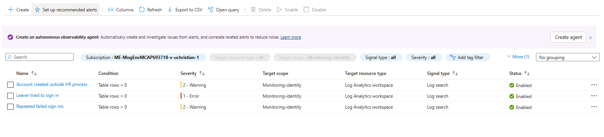

### The test events

**2. Bushayija David is created by hand.** Microsoft Entra ID > Audit logs, the entry at 11:33 PM on 26 October 2026: Activity Type Add user, category UserManagement, status success. Initiated by (actor): Type User, object ID c0bafe06-a978-4be8-9b56-725485107164, the admin@ account. A person, not the HR feed, created the account.

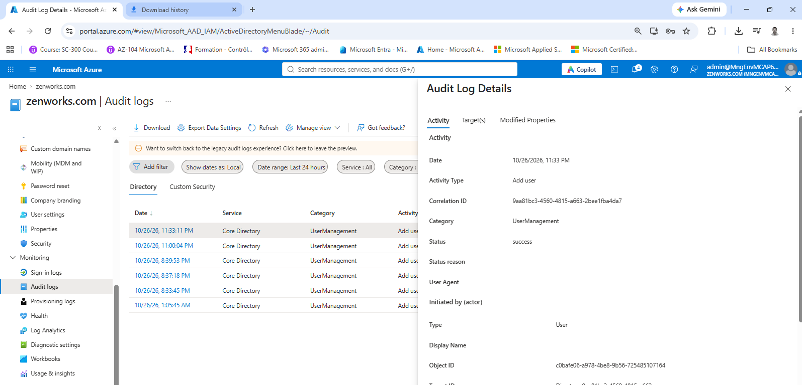

**3. The account that was created.** The Target(s) tab of the same 11:33:11 PM entry: a User, ID 040fcc6d-7378-46cb-826c-ba8570821cd3, user principal name dbushayija@MngEnvMCAP693718.onmicrosoft.com.

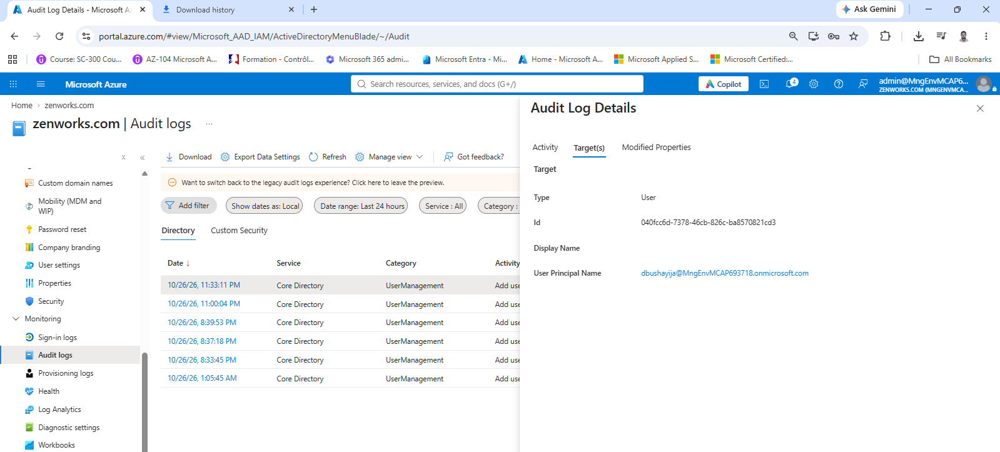

**4. Fabrice Uwitonze is disabled as a leaver.** Fabrice Uwitonze's Overview page: created Oct 26, 2026, 8:39 PM, Account status Disabled, and no sign-in yet (last interactive sign-in shows dashes).

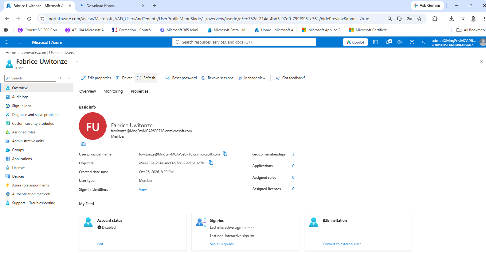

**5. Fabrice tries to sign in and is refused.** Sign-in logs, dates in UTC. The sign-in by fuwitonze at 2026-10-26T21:36:05Z (11:36 PM local) failed with error 50057, "The user account is disabled."

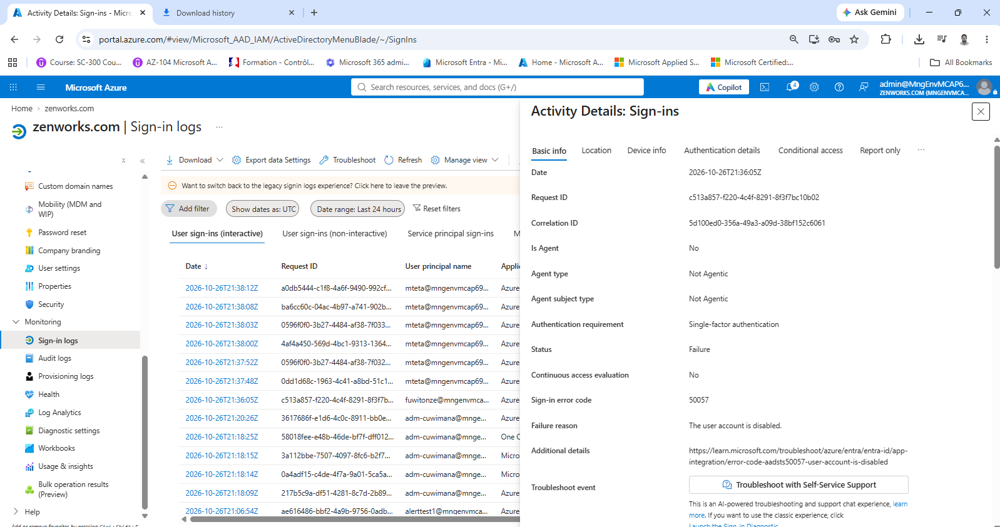

**6. Six wrong passwords for Melissa Teta.** The same sign-in log: six failed sign-ins by mteta between 2026-10-26T21:37:48Z and 21:38:12Z (11:37 to 11:38 PM local). The selected one, at 21:38:12Z, failed with error 50126, "Error validating credentials due to invalid username or password."

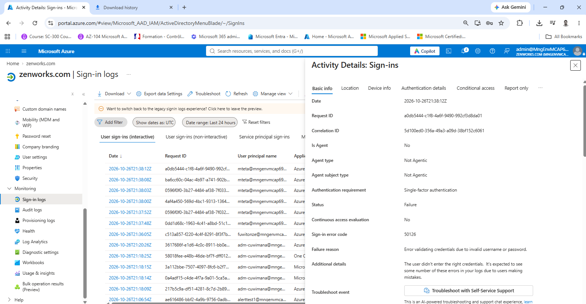

### The alerts fire

**7. Alerts fired in Azure Monitor.** Monitor > Alerts, past 24 hours, condition Fired: Repeated failed sign-ins (2 - Warning) at 11:42 PM and Leaver tried to sign in (1 - Error) at 11:39 PM, both on monitoring-identity. The Account created outside HR process alert listed, at 11:04 PM, came from a test account, alerttest1, created at 11:00 PM (the 11:00:04 PM Add user entry in screenshot 2); Bushayija's own alert is in screenshot 8. Backup Failure belongs to another setup and is not part of this project.

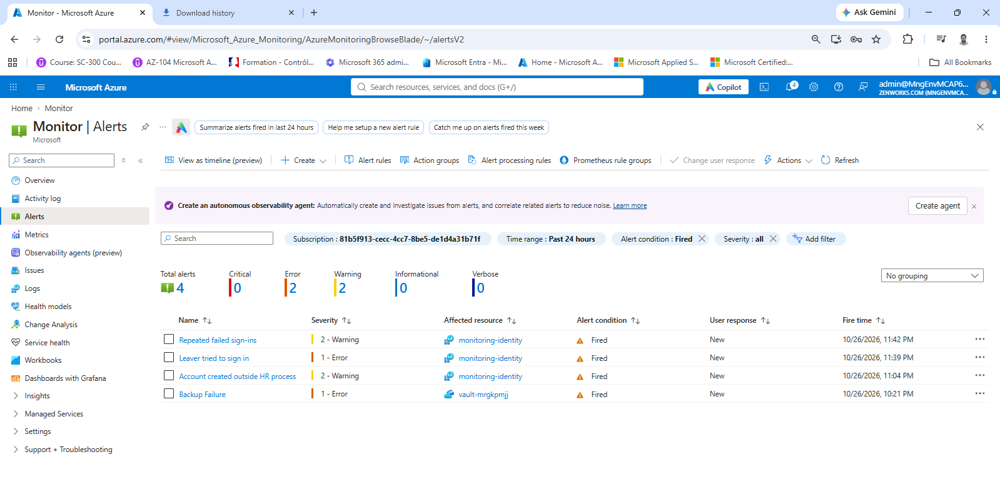

**8. Email: account created outside HR process.** The alert email in the IAM mailbox (Outlook on the lab VM, times in UTC), received at 10:09 PM UTC (12:09 AM local, 27 October): the query crossed the threshold of 0 and reached 1; Count, Greater Than, 0; description "A person created a user by hand instead of through the HR feed." Under Dimensions, NewUser = dbushayija@MngEnvMCAP693718.onmicrosoft.com, so the email names the account. The inbox also shows the other two alerts' "was resolved" emails: they close by themselves.

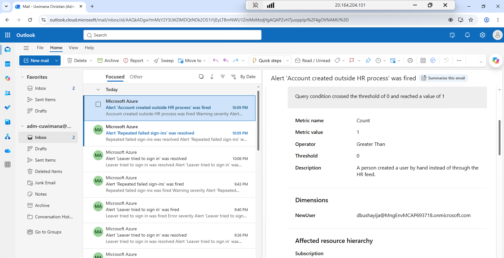

**9. Email: leaver tried to sign in.** Received at 9:40 PM UTC (11:40 PM local), Error severity: the query crossed the threshold of 0 and reached 1. Just below it, the 9:36 PM "was resolved" email shows the rule's previous alert had closed before this one opened.

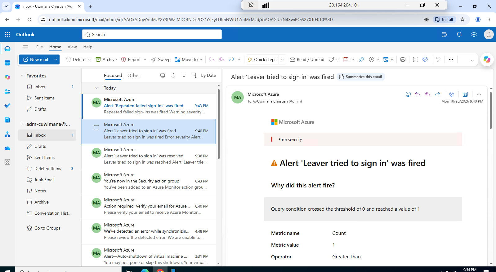

**10. Email: repeated failed sign-ins.** Received at 9:43 PM UTC (11:43 PM local), Warning severity: the query crossed the threshold of 0 and reached 1, meaning one account had five or more wrong passwords.

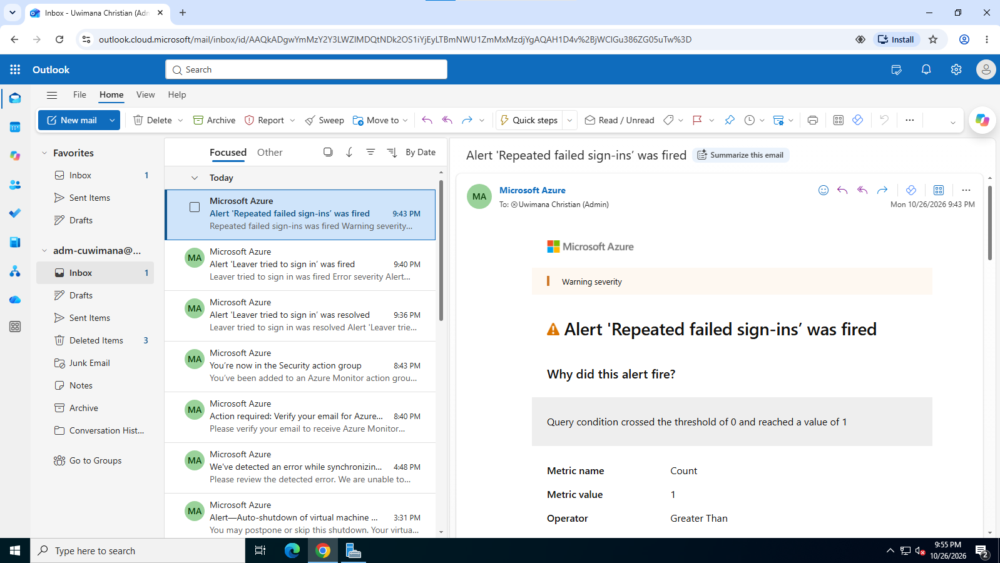

### The IAM dashboard

**11. One dashboard for sign-ins and account changes.** Monitoring-identity > Workbooks, the saved IAM dashboard. Top: successful sign-ins by authentication requirement, 23 in all, 16 multi-factor and 7 single-factor. Below it: account changes from the audit log, one bar each for Update user, Add user, Disable account and Delete user. The workspace has collected logs since 26 October 2026, so the counts cover the test days.

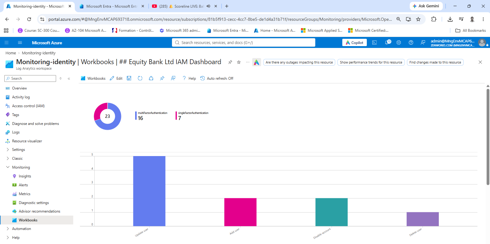

**12. Account changes and failed sign-ins.** Scrolled down. The account-change counts: Update user 5, Add user 2, Disable account 2, Delete user 1. The bottom chart ranks accounts by failed sign-ins over the last 7 days: alerttest1 12, mteta 7 (including the six wrong passwords in screenshot 6), adm-cuwimana 3, and fuwitonze 1 (the refused leaver sign-in in screenshot 5). The three queries are in dashboard-queries.kql.

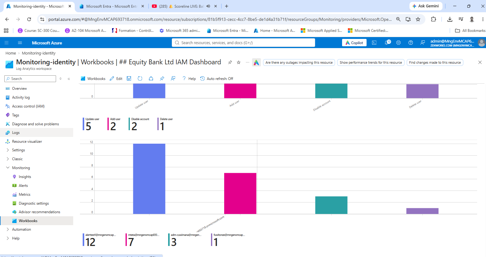

### The quarterly access review

**13. Melissa Teta is denied, with a reason.** My Access on the lab VM, signed in as Uwimana Christian (Admin), the reviewer of Client Statements Viewers - Quarterly review: "Please review assignment to 'Client Statements - Viewers'". Both members carry the recommendation Deny, marked Inactive user. Melissa Teta's panel: Denied by Uwimana Christian (Admin) on Oct 26, 2026, 10:57 PM GMT (12:57 AM local, 27 October), reason "Accountant, no client-facing role".

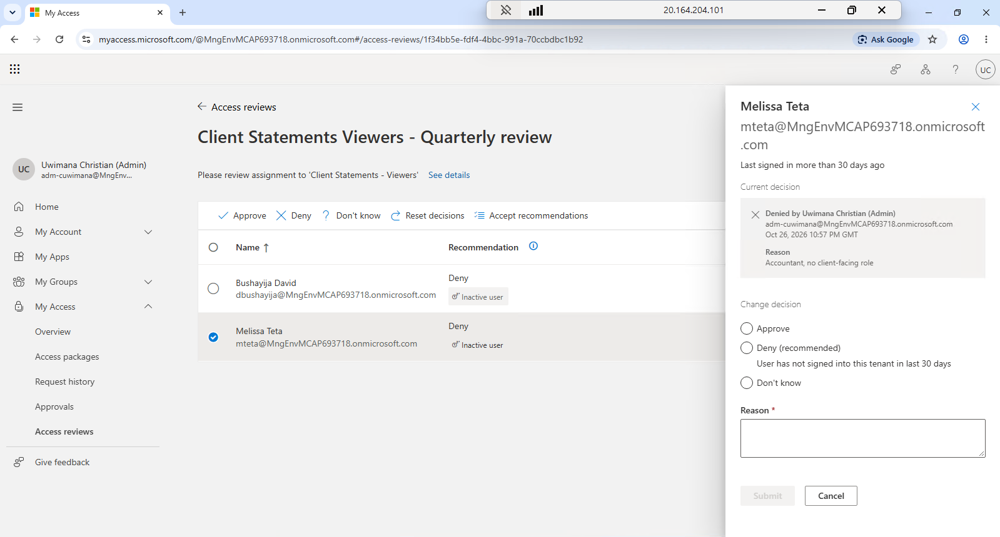

**14. Bushayija David is approved, against the recommendation.** The same review, Bushayija David's panel: Approved by Uwimana Christian (Admin) at the same time, reason "Relationship manager, serves corporate". The system recommended Deny because he has not signed in within 30 days, but he is client-facing, so the reviewer kept his access and recorded why.

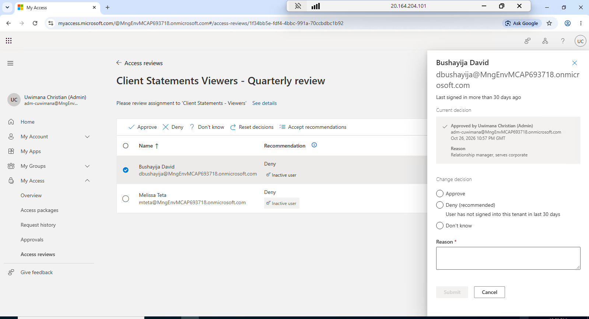

**15. The review applies the decisions.** The review was due on 2 November; it was stopped early, and its results are under Review history > Results. Status: Applied by Access Reviews, Applied Date 10/27/2026. Melissa Teta: outcome Denied, recommended action Deny, reviewed by Uwimana Christian (Admin), apply result Success, "Successfully removed from m..." (cut off). Bushayija David: outcome Approved, so nothing to apply.

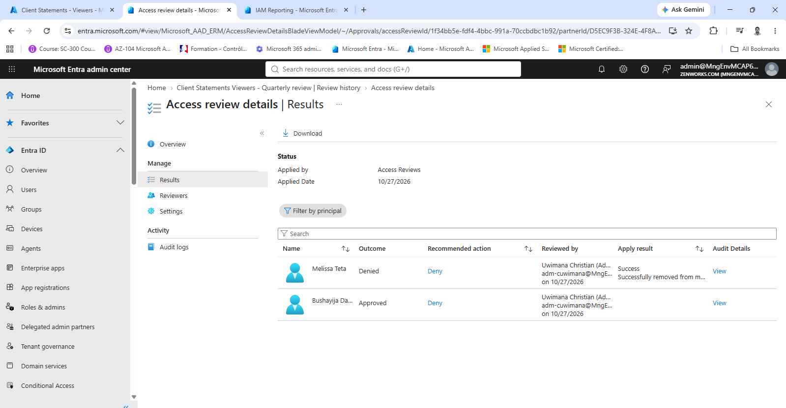

**16. Removed by the review, not by a person.** Microsoft Entra ID > Audit logs, dates shown as local: the entry at 1:18:29 AM on 27 October 2026, Activity Type Remove member from group, category GroupManagement, status success. Initiated by (actor): Type Application, Display Name Request Approvals Read Platform. No person made the change, which matches "Applied by Access Reviews" in screenshot 15.

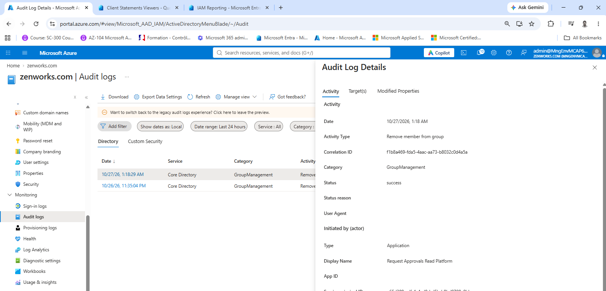

**17. Who was removed, and from which group.** The Target(s) tab of the same entry: the User mteta@MngEnvMCAP693718.onmicrosoft.com (ID 6f8b664f-cb52-4571-8461-081f509a4d82), and the Group with ID 292aef5b-35f2-4c13-bd3a-9a6a3b38698c, which is Client Statements - Viewers (the same ID is in the address bar of screenshot 18).

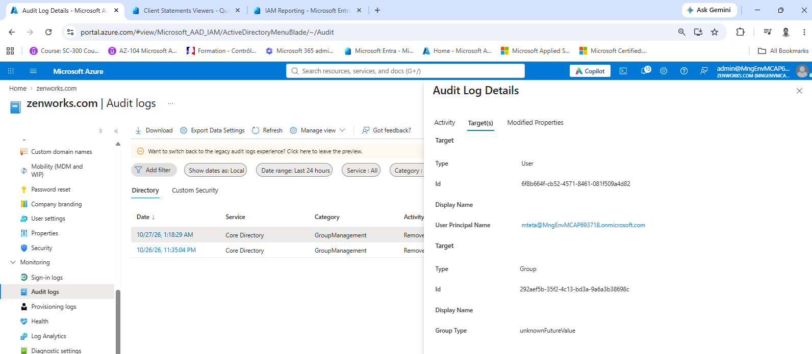

**18. Only Bushayija David is left.** Groups > Client Statements - Viewers > Members, group ID 292aef5b-35f2-4c13-bd3a-9a6a3b38698c in the address bar: 1 group member found, Bushayija David, Object Id 040fcc6d-7378-46cb-826c-ba8570821cd3, the account created by hand in screenshot 3. Melissa Teta is gone.

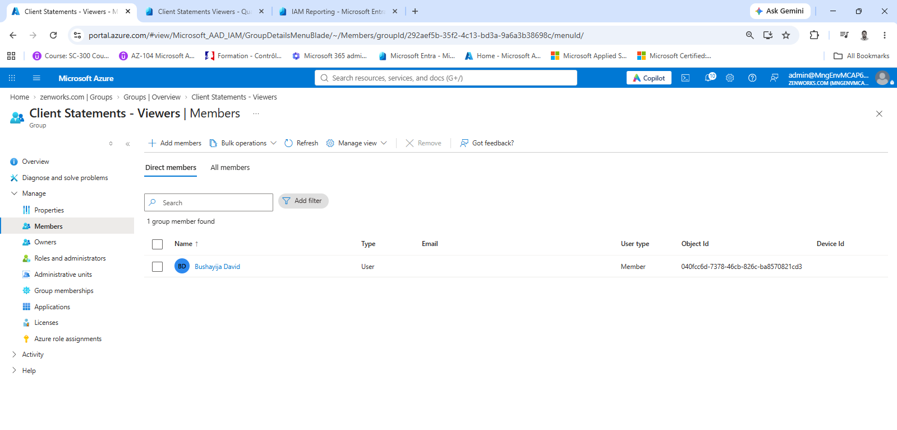

### The dormant-account report

**19. A Logic App on a weekly schedule.** Logic app Dormant_accounts in the designer: five steps, Recurrence, HTTP, Filter array, Create CSV table and Send an email (V2). The Recurrence trigger runs every 1 Week, time zone (UTC+02:00) Harare, Pretoria, on Monday, at hour 7, minute 0. The Preview reads "Runs at 7:00 on Monday every week", so nobody has to remember to run the report.

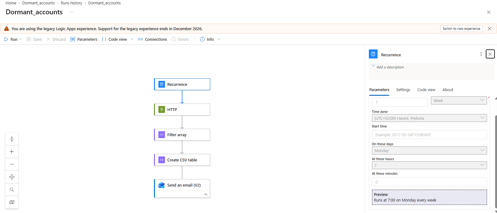

**20. The report runs, every step green.** Logic app Dormant_accounts > Runs history: three runs on 27 October, all Succeeded. The two 2:00 AM runs were tests made before the CSV columns were fixed. The 2:04 AM run is open: Recurrence, HTTP (reads every user and their last sign-in from Microsoft Graph), Filter array (keeps employee IDs starting 1004 with no successful sign-in in 90 days, or never), Create CSV table and Send an email (V2), each with a green tick. The run started at 2:04:55 AM local time, status Succeeded.

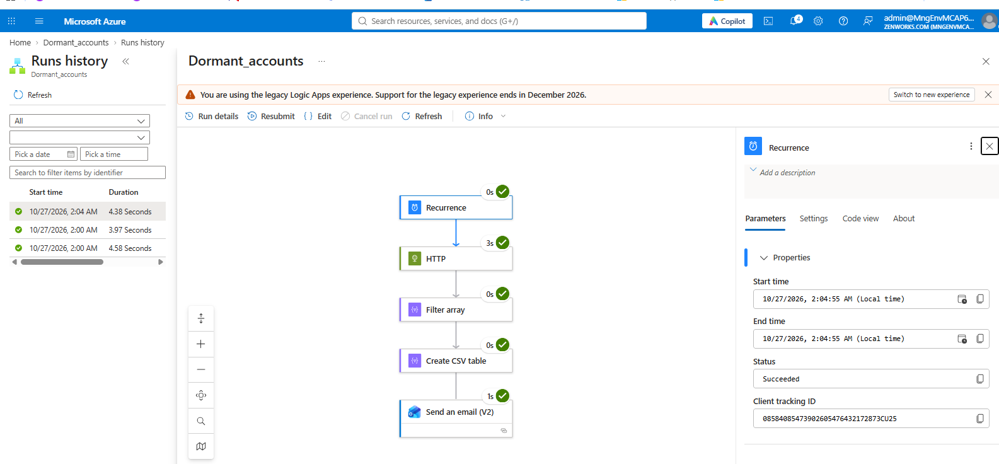

**21. The report arrives by email.** The IAM mailbox (Outlook on the lab VM, times in UTC): "Dormant accounts report" from System Administrator, received Tue 10/27/2026 12:05 AM UTC (2:05 AM local), with dormant-accounts.csv (532 bytes) attached and the body "Accounts with no successful sign-in in 90 days, or never, are attached".

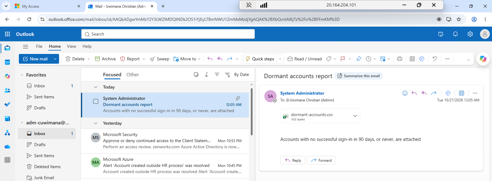

**22. Three accounts that have never signed in.** The attached CSV opened, with the columns Name, Sign-in name, Employee ID, Account enabled and Last sign-in: Bushayija David (100401, enabled), Fabrice Uwitonze (100403, disabled) and Melissa Teta (100402, enabled), all with Last sign-in Never. The two enabled accounts are the ones to act on; Fabrice's is already disabled.

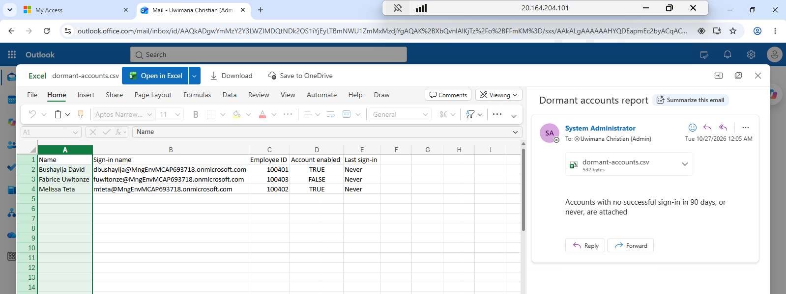
